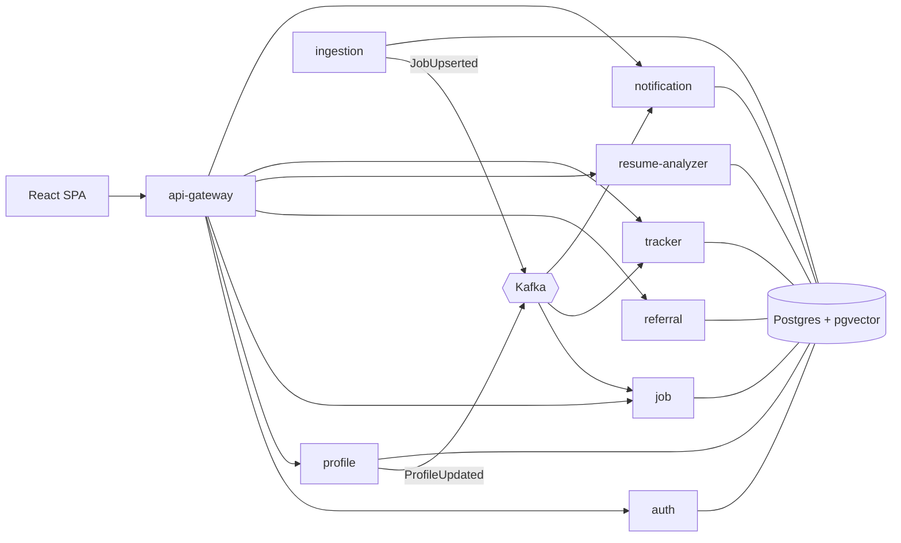

# ReferBoard

Referral-first job search for India and remote tech roles: find relevant jobs, see why you match, and get
referred instead of applying cold. ReferBoard drafts outreach; **you** always send it yourself.

- Architecture, schemas and event contracts: [`docs/ARCHITECTURE.md`](docs/ARCHITECTURE.md)
- Stack: Java 21, Spring Boot 3.5, Spring Cloud 2025.0 (Gateway, Eureka), PostgreSQL 16 + pgvector, Kafka,
  Redis, React 18 + TypeScript + Vite.



## Build status (Phase 1)

| Module | Status | Tests |
|---|---|---|
| event-contracts | ✅ | contract round-trip + forward compatibility |
| common-lib | ✅ | correlation-id sanitising |
| test-support | ✅ | (fixtures: Postgres+pgvector, test JWTs) |
| skills | ✅ | 7 — aliases (K8s→Kubernetes), ambiguous words ("Go", "Excel"), extraction offsets |
| ai-client | ✅ | 9 — Claude/OpenAI request shape, retries on 429/5xx/529, no retry on 4xx, embeddings |
| discovery-server | ✅ | boots, health UP |
| auth-service | ✅ | 15 unit + 7 integration (real Postgres, embedded Kafka) |
| profile-service | ✅ | 21 unit + 4 integration (real PDF/DOCX → parse → pgvector → Kafka) |
| ingestion-service | ⏳ next | |
| job-service | ⏳ | |
| referral-service | ⏳ | |
| resume-analyzer-service | ⏳ | |
| tracker-service | ⏳ | |
| notification-service | ⏳ | |
| api-gateway | ⏳ | |
| frontend | ⏳ | |

## Run locally with Docker

```bash
cp .env.example .env          # defaults work for local; add GOOGLE_CLIENT_ID to enable Google sign-in
docker compose up --build     # postgres+pgvector, redis, kafka, eureka, and every built service
docker compose --profile tools up kafka-ui   # optional Kafka UI on :8090
```

| URL | What |
|---|---|
| http://localhost:8761 | Eureka dashboard |
| http://localhost:8081/swagger-ui.html | auth-service API docs |
| http://localhost:8081/.well-known/jwks.json | public signing keys |
| http://localhost:8082/swagger-ui.html | profile-service API docs |

Try it:

```bash
curl -i -X POST localhost:8081/api/auth/signup -H 'Content-Type: application/json' \
  -d '{"email":"you@example.com","password":"Passw0rdOK","fullName":"You"}'
# → 201, body has accessToken; refresh token is in the rb_refresh httpOnly cookie
curl localhost:8081/api/auth/me -H "Authorization: Bearer <accessToken>"

# upload a resume (PDF/DOCX/DOC/TXT ≤ 5 MB); parsing runs in the background
curl -X POST localhost:8082/api/profile/resumes -H "Authorization: Bearer <accessToken>" -F "file=@my-cv.pdf"
curl localhost:8082/api/profile/resumes/<id> -H "Authorization: Bearer <accessToken>"   # until parseStatus=PARSED
curl localhost:8082/api/profile -H "Authorization: Bearer <accessToken>"                # structured profile
```

### AI providers (optional)

Everything runs without API keys. With none set, resumes are parsed by a deterministic heuristic parser and
embeddings use a local hashing model, so matching works but is cruder, and the profile is marked
`parseSource: HEURISTIC` so the UI asks the user to review it. Add keys to `.env` for the real thing:

| Setting | Effect |
|---|---|
| `ANTHROPIC_API_KEY` | resume (and later JD) parsing and message drafting with Claude (`ANTHROPIC_MODEL`, default `claude-sonnet-5-5`) |
| `OPENAI_API_KEY` | embeddings (`text-embedding-3-small`, 1536-d); also used for parsing if no Anthropic key |
| `LLM_PROVIDER` / `EMBEDDING_PROVIDER` | force `anthropic`/`openai`/`none` and `openai`/`hashing` instead of `auto` |

After adding a key, `POST /api/profile/resumes/{id}/reparse` re-parses an existing resume.

## Run tests

```bash
mvn verify                    # unit tests + integration tests (Testcontainers starts pgvector/pgvector:pg16)
mvn test                      # unit tests only
mvn verify -Dit.db=local      # integration tests against a local Postgres instead of Docker
#   uses IT_DB_URL (default jdbc:postgresql://localhost:5432/), IT_DB_USER/IT_DB_PASSWORD (postgres/postgres);
#   needs the pgvector extension installed; a throwaway database is created and dropped per run
```

Kafka in integration tests is Spring Kafka's embedded KRaft broker (no Docker needed).

## Run a service from your IDE

Start infrastructure only: `docker compose up postgres kafka redis discovery-server`, then run the service's
`*Application` class. Defaults point at `localhost`; Kafka's host listener is `localhost:29092`, so set
`KAFKA_BOOTSTRAP_SERVERS=localhost:29092` in the run configuration.

## Environment variables

All configuration is via environment variables; see [`.env.example`](.env.example) for the full list with
comments. The ones that matter today:

| Variable | Used by | Notes |
|---|---|---|
| `JWT_PRIVATE_KEY` / `JWT_PUBLIC_KEY` | auth-service | PEM or base64 PEM. Empty locally ⇒ generated once into the `authkeys` volume. **Required in production.** |
| `JWT_ISSUER`, `JWT_AUDIENCE` | all services | must match between auth-service and verifiers |
| `GOOGLE_CLIENT_ID` | auth-service | empty ⇒ `/api/auth/google` returns 503 |
| `AUTH_COOKIE_SECURE` | auth-service | keep `true`; browsers accept Secure cookies on `http://localhost` |
| `DB_URL`, `DB_USERNAME`, `DB_PASSWORD` | each service | each service has its own role and schema (see `docker/postgres/init.sql`) |
| `KAFKA_BOOTSTRAP_SERVERS` | each service | |
| `EUREKA_URL` | each service | |
| `LOG_FORMAT` | each service | `ecs` for structured JSON logs; empty for plain text |

## Adding skills to the taxonomy

Skill names are normalised everywhere (profiles, jobs, JD analysis) through
`platform/skills/src/main/resources/referboard/skills.yml`. Add an entry with its aliases; words that are also
ordinary English ("Go", "Excel", "Spring") go under `strict:` so they only match when written exactly that way in
free text. `SkillTaxonomyTest` fails on alias collisions.

## Adding companies to the job seed list

*(Lands with ingestion-service.)* Companies are listed in
`services/ingestion-service/src/main/resources/companies.yml` and synced into `ingestion.company_sources` on
startup:

```yaml
companies:
  - name: Razorpay
    ats: GREENHOUSE      # GREENHOUSE | LEVER | ASHBY
    slug: razorpay       # the board token in the public URL, e.g. boards.greenhouse.io/<slug>
```

Find the slug from the company's public careers page URL (`boards.greenhouse.io/<slug>`,
`jobs.lever.co/<slug>`, `jobs.ashbyhq.com/<slug>`). Only these documented public board APIs and Adzuna are
called; no site whose terms prohibit automated access is ever fetched.

## Deployment notes

- Build images with `docker/service.Dockerfile` (`--build-arg MODULE=services/<name>`); images run as non-root,
  in UTC, with layered jars.
- Provide real JWT keys, distinct DB passwords per service role, and `LOG_FORMAT=ecs`.
- Every service exposes `/actuator/health/liveness` and `/actuator/health/readiness` for orchestrator probes.
- Postgres needs the `vector` and `pg_trgm` extensions (`docker/postgres/init.sql` shows the bootstrap).
