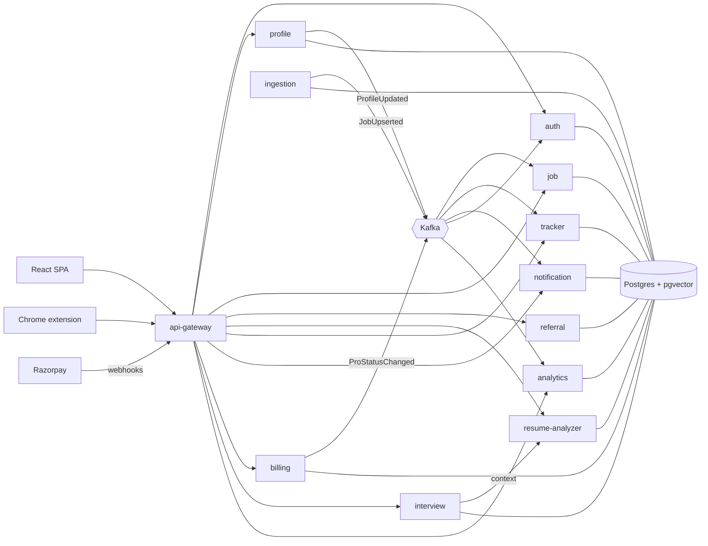

# ReferBoard

Referral-first job search for India and remote tech roles: find relevant jobs, see why you match, and get
referred instead of applying cold. ReferBoard drafts outreach; **you** always send it yourself.

- Architecture, schemas and event contracts: [`docs/ARCHITECTURE.md`](docs/ARCHITECTURE.md)
- Deploying for free on Oracle Cloud: [`docs/DEPLOY-ORACLE.md`](docs/DEPLOY-ORACLE.md)
- Stack: Java 21, Spring Boot 3.5, Spring Cloud 2025.0 (Gateway, Eureka), PostgreSQL 16 + pgvector, Kafka,
  Redis, React 18 + TypeScript + Vite.



## Build status (Phases 1, 2 and 3)

| Module | Status | Tests |
|---|---|---|
| event-contracts | ✅ | contract round-trip + forward compatibility |
| common-lib | ✅ | correlation-id sanitising |
| test-support | ✅ | (fixtures: Postgres+pgvector, test JWTs) |
| skills | ✅ | 7 — aliases (K8s→Kubernetes), ambiguous words ("Go", "Excel"), extraction offsets |
| ai-client | ✅ | 9 — Claude/OpenAI request shape, retries on 429/5xx/529, no retry on 4xx, embeddings |
| discovery-server | ✅ | boots, health UP |
| auth-service | ✅ | 16 unit + 10 integration (real Postgres, embedded Kafka; web and extension sessions; Pro role from billing events, stale ones ignored) |
| profile-service | ✅ | 21 unit + 5 integration (real PDF/DOCX → parse → pgvector → Kafka; concurrent-onboarding race) |
| ingestion-service | ✅ | 54 unit + 2 integration (4 simulated runs over 61 days against mock ATS APIs; force-republish) |
| job-service | ✅ | 5 unit + 4 integration (events → FTS/trigram/pgvector search, Redis cache, matches, DLT, digest) |
| referral-service | ✅ | 34 unit + 5 integration (Feign → mock job/profile/Claude APIs, draft guard, pipeline events, reminders on a movable clock) |
| resume-analyzer-service | ✅ | 38 unit + 8 integration (LLM + heuristic paths, truth guard, tailored DOCX/PDF, cover letters and their guard, free-tier limit, JD cache) |
| tracker-service | ✅ | 7 unit + 6 integration (board API, drag-and-drop ordering, referral/resume/closed-job events, create race) |
| notification-service | ✅ | 5 unit + 7 integration (real SMTP via GreenMail: escaping, outage + retry, one-click unsubscribe, daily cap, dedup; Pro and interview nudges) |
| billing-service (Phase 3) | ✅ | 2 unit + 6 integration (Razorpay mocked over HTTP: real signatures, verify-once, capture of authorised payments, stacking passes, webhooks for abandoned checkouts, repeats and forgeries, refunds) |
| interview-service (Phase 3) | ✅ | 8 unit + 4 integration (question bank, evidence only from resume bullets, AI questions with a bad index dropped, free-tier limit, practice with optimistic locking) |
| analytics-service (Phase 3) | ✅ | 1 integration (all 7 topics, out of order and redelivered, IST weeks, minimum sample before a rate) |
| api-gateway | ✅ | 5 unit + 9 integration (edge JWT via JWKS, CORS, Redis token buckets, fail-open, JSON errors, docs aggregation) |
| frontend | ✅ | 17 unit (token refresh, board moves, formatting, Razorpay checkout outcomes) + Playwright smoke and Phase 3 journeys (buy Pro, prep and practise, insights) on desktop and mobile against the live stack |
| extension (Phase 2) | ✅ | 21 unit (site rules, page reading, session refresh, popup) + Playwright with the extension loaded in Chromium |

## Run locally with Docker

```bash
cp .env.example .env          # defaults work for local; add GOOGLE_CLIENT_ID to enable Google sign-in
docker compose up --build     # postgres+pgvector, redis, kafka, eureka, every service, and the web app
docker compose --profile tools up kafka-ui   # optional Kafka UI on :8090
```

| URL | What |
|---|---|
| http://localhost:3000 | **The web app** (nginx serving the React build; `/api` is proxied to the gateway) |
| http://localhost:8080 | API gateway: the only backend address the frontend uses (published on localhost only) |
| http://localhost:8080/swagger-ui.html | all services' API docs in one Swagger UI (requests go through the gateway) |
| http://localhost:8761 | Eureka dashboard |
| http://localhost:8081/swagger-ui.html | auth-service API docs |
| http://localhost:8081/.well-known/jwks.json | public signing keys |
| http://localhost:8082/swagger-ui.html | profile-service API docs |
| http://localhost:8083/swagger-ui.html | job-service API docs (search, detail + match breakdown, recommendations) |
| http://localhost:8084/swagger-ui.html | ingestion admin API (ADMIN role) |
| http://localhost:8085/swagger-ui.html | referral-service API docs (people to reach, drafts, CRM, reminders) |
| http://localhost:8086/swagger-ui.html | resume-analyzer-service API docs (JD Match Analyzer, tailored resumes) |
| http://localhost:8087/swagger-ui.html | tracker-service API docs (application board) |
| http://localhost:8088/swagger-ui.html | notification-service API docs (inbox, email preferences) |
| http://localhost:8089/swagger-ui.html | billing-service API docs (Pro passes, Razorpay) |
| http://localhost:8091/swagger-ui.html | interview-service API docs (prep packs) |
| http://localhost:8092/swagger-ui.html | analytics-service API docs (insights) |
| http://localhost:8025 | Mailpit: every email the app sends locally |

Try it:

```bash
curl -i -X POST localhost:8081/api/auth/signup -H 'Content-Type: application/json' \
  -d '{"email":"you@example.com","password":"Passw0rdOK","fullName":"You"}'
# → 201, body has accessToken; refresh token is in the rb_refresh httpOnly cookie
curl localhost:8081/api/auth/me -H "Authorization: Bearer <accessToken>"

# upload a resume (PDF/DOCX/DOC/TXT ≤ 5 MB); parsing runs in the background
curl -X POST localhost:8082/api/profile/resumes -H "Authorization: Bearer <accessToken>" -F "file=@my-cv.pdf"
curl localhost:8082/api/profile/resumes/<id> -H "Authorization: Bearer <accessToken>"   # until parseStatus=PARSED
curl localhost:8082/api/profile -H "Authorization: Bearer <accessToken>"                # structured profile

# jobs: search with filters, each result carries your live match %
curl "localhost:8083/api/jobs?location=Bangalore&q=kafka&postedWithinDays=14" -H "Authorization: Bearer <accessToken>"
curl "localhost:8083/api/jobs/recommended" -H "Authorization: Bearer <accessToken>"
curl "localhost:8083/api/jobs/<jobId>/match" -H "Authorization: Bearer <accessToken>"     # score breakdown
```

### AI providers (optional)

Everything runs without API keys. With none set, resumes are parsed by a deterministic heuristic parser and
embeddings use a local hashing model, so matching works but is cruder, and the profile is marked
`parseSource: HEURISTIC` so the UI asks the user to review it. Add keys to `.env` for the real thing:

| Setting | Effect |
|---|---|
| `ANTHROPIC_API_KEY` | resume (and later JD) parsing and message drafting with Claude (`ANTHROPIC_MODEL`, default `claude-sonnet-5-5`) |
| `OPENAI_API_KEY` | embeddings (`text-embedding-3-small`, 1536-d); also used for parsing if no Anthropic key |
| `LLM_PROVIDER` / `EMBEDDING_PROVIDER` | force `anthropic`/`openai`/`none` and `openai`/`hashing` instead of `auto` |

After adding a key, `POST /api/profile/resumes/{id}/reparse` re-parses an existing resume.

## Run tests

```bash
mvn verify                    # unit tests + integration tests (Testcontainers starts pgvector/pgvector:pg16)
mvn test                      # unit tests only
mvn verify -Dit.db=local      # integration tests against a local Postgres instead of Docker
#   uses IT_DB_URL (default jdbc:postgresql://localhost:5432/), IT_DB_USER/IT_DB_PASSWORD (postgres/postgres);
#   needs the pgvector extension installed; a throwaway database is created and dropped per run
```

Kafka in integration tests is Spring Kafka's embedded KRaft broker (no Docker needed).

Frontend (in `frontend/`):

```bash
npm ci
npm test                      # Vitest unit tests
npm run typecheck && npm run build
npm run dev                   # Vite on :5173, proxying /api to GATEWAY_URL (default http://localhost:8080)
# End-to-end smoke test (sign up, onboard, jobs, analyzer, referrals, tracker, inbox, settings, reload, sign out)
# against a running stack, on a desktop and a phone viewport. E2E_SCREENSHOTS=1 saves each screen to e2e-screens/.
E2E_BASE_URL=http://localhost:3000 npx playwright test
# The Phase 3 journey pays through a local stand-in for Razorpay (e2e/support/mock-razorpay.mjs on :9001):
# start billing-service with RAZORPAY_API_BASE_URL=http://localhost:9001 and the test keys in that file.
```

## Run a service from your IDE

Start infrastructure only: `docker compose up postgres kafka redis discovery-server`, then run the service's
`*Application` class. Defaults point at `localhost`; Kafka's host listener is `localhost:29092`, so set
`KAFKA_BOOTSTRAP_SERVERS=localhost:29092` in the run configuration.

## Environment variables

All configuration is via environment variables; see [`.env.example`](.env.example) for the full list with
comments. The ones that matter today:

| Variable | Used by | Notes |
|---|---|---|
| `JWT_PRIVATE_KEY` / `JWT_PUBLIC_KEY` | auth-service | PEM or base64 PEM. Empty locally ⇒ generated once into the `authkeys` volume. **Required in production.** |
| `JWT_ISSUER`, `JWT_AUDIENCE` | all services | must match between auth-service and verifiers |
| `GOOGLE_CLIENT_ID` | auth-service | empty ⇒ `/api/auth/google` returns 503 |
| `AUTH_COOKIE_SECURE` | auth-service | keep `true`; browsers accept Secure cookies on `http://localhost` |
| `DB_URL`, `DB_USERNAME`, `DB_PASSWORD` | each service | each service has its own role and schema (see `docker/postgres/init.sql`) |
| `KAFKA_BOOTSTRAP_SERVERS` | each service | |
| `EUREKA_URL` | each service | |
| `LOG_FORMAT` | each service | `ecs` for structured JSON logs; empty for plain text |
| `RAZORPAY_KEY_ID`, `RAZORPAY_KEY_SECRET`, `RAZORPAY_WEBHOOK_SECRET` | billing-service | empty ⇒ Pro shows as unavailable and payment endpoints return 503 |
| `PRO_MONTH_PRICE_PAISE`, `PRO_YEAR_PRICE_PAISE` | billing-service | prices of the 30- and 365-day passes |
| `INTERVIEW_FREE_PACKS_PER_MONTH` | interview-service | default 3; Pro and ADMIN are unlimited |

## How the web app works

React 18 + TypeScript on Vite, React Router, TanStack Query, Tailwind with a small set of Radix-based
components (dialog/sheet, tabs), dnd-kit for the tracker board, sonner for toasts.

- **Session:** the access token lives only in memory (never in localStorage); the refresh token is the
  httpOnly `rb_refresh` cookie scoped to `/api/auth`. On load the app calls `/api/auth/refresh` to restore the
  session. An Axios interceptor retries a request once after a 401 with a refreshed token. All refreshes share
  one in-flight call: refresh tokens rotate, and two concurrent refreshes with the same cookie would look like
  token theft. If a refresh fails mid-session, the app signs out with a toast.
- **Pages:** Landing, Sign in / Create account (email or Google), Onboarding (upload → check what we read →
  preferences), Jobs (recommended and search, with filters in the URL), Job detail (fit panel, Check my
  resume, Find people to ask), JD Analyzer (job, pasted text or file; report with score breakdown, edits you
  approve one by one, ATS checks, tailored DOCX/PDF), Referral assistant (who to reach, LinkedIn search links,
  your contacts and drafts), Referrals CRM (status pipeline, due follow-ups), Tracker (drag-and-drop board),
  Inbox, Settings (resumes, tailored resumes, job preferences, email, analyzer usage, plan and payments, sign out),
  and from Phase 3: Interview prep (packs and practice), Insights, ReferBoard Pro, and Admin (ADMIN only).
- **Edits you approve:** only mechanical edits (skill order, the posting's spelling of a skill you have)
  start ticked. Anything that replaces your own sentences starts unticked. Anything that adds something new
  needs a separate "Add only if you have this experience" confirmation before the button enables.
- **Drafts are yours to send:** connection notes show a 300-character counter; the app copies text to the
  clipboard and links to LinkedIn search. It never opens a LinkedIn profile or sends anything itself.
- **Look:** ink (#1B2440) on a cool paper background, Bricolage Grotesque for headings and IBM Plex Sans for
  text. Marigold is kept for referral moments (the thread from you to the company) and green only for match
  data. Respects reduced motion; visible keyboard focus; skip link; phone layout with a bottom tab bar.
- **Serving:** `frontend/Dockerfile` builds the app and serves it with nginx (`frontend/docker/nginx.conf`):
  SPA fallback, year-long caching for hashed assets, `no-cache` for the shell, a strict CSP (self plus
  Google's sign-in script and Razorpay Checkout), and `/api` proxied to the gateway on the same origin, so no CORS is involved.
  nginx overwrites `X-Forwarded-For` with the client address; the gateway trusts it
  (`TRUST_FORWARDED_FOR=true`) and is published on localhost only, so the header can't be spoofed from outside.

## How the browser extension works

`extension/` is a Chrome (MV3) extension with no build step: **Load unpacked** in `chrome://extensions`. On a
careers page, click its icon to save the job to the tracker, check your resume against it, and write a cover
letter. It reads a page only on that click, and only the schema.org JobPosting data careers sites publish for search
engines (or text you selected). It never runs on LinkedIn, Naukri, Indeed or other job boards, where you paste the
description instead. It never sends messages.

To connect, the signed-in web app (`/connect-extension`) creates an extension session after you approve it, and
hands it to the extension with `chrome.runtime.sendMessage`. That only works for the extension IDs in
`EXTENSION_IDS` and from the origins in the manifest. Extension sessions are separate, rotating, revocable token
families (`/api/auth/extension/*`), shown in **Settings → Browser extension**. Details are in
[`extension/README.md`](extension/README.md).

## How the referral assistant works

ReferBoard never visits LinkedIn and never sends anything. For a job, `GET /api/referrals/jobs/{jobId}/suggestions`
returns the kinds of people worth reaching (recruiters, engineering managers, people in the same role, alumni of your
college, people who share a past employer), each with a LinkedIn people-search link that you open yourself. You add
the people you choose as contacts (name, profile URL and/or headline; the URL is validated as text, never fetched).

`POST /api/referrals/contacts/{id}/drafts` writes a connection note (≤300 characters, LinkedIn's limit) and a
referral request, each in a WARM and a CONCISE tone, or follow-ups (`{"type":"FOLLOW_UP"}`). Drafts use only facts
from your profile and the job:

- With an `ANTHROPIC_API_KEY` (or OpenAI) the LLM drafts; every draft is then checked. A note over 300 characters is
  shortened at a sentence boundary; a draft containing a **number that isn't in your resume or the job** (an invented
  metric, team size or years of experience) or a placeholder like `[Name]` is replaced with the template draft. The
  response says how many were replaced.
- Without a key, or past `REFERRAL_MAX_AI_DRAFTS_PER_DAY` (default 120 per user per day), template drafts are built
  from the same facts. Achievements are resume bullets quoted verbatim.

You record what you did by moving the contact: `NOT_CONTACTED → REQUEST_SENT → CONNECTED → REFERRAL_ASKED → REFERRED`,
with `NO_RESPONSE` from any contacted state (and back, if they reply). Each status gets a timestamp and a history row,
and publishes `referral.status-changed.v1`. Two reminders are scheduled automatically and fire only if the contact is
still in that status: *connected 2 days ago → send your referral message* and *no reply 5 days after asking → follow
up* (`referral.reminder-due.v1`, with a drafted message; notification-service will email them). Tune with
`REFERRAL_SEND_REFERRAL_AFTER` / `REFERRAL_FOLLOW_UP_AFTER` (ISO-8601 durations).

## How the API gateway works

Everything the frontend calls goes to `http://localhost:8080/api/...`. The gateway:

- **Routes by path** to services found through Eureka (`/api/auth` → auth-service, `/api/jobs` → job-service,
  `/api/analyses` and `/api/resume-versions` → resume-analyzer-service, and so on). Only `/api/**`, the JWKS and the
  API docs are routed; services' actuator endpoints are never exposed. LLM-backed services get a 120 s timeout,
  others 30 s.
- **Validates the JWT at the edge** (signature from auth-service's JWKS, issuer, audience, expiry); invalid tokens
  never reach a service, and services validate again. Sign-up, login, refresh, logout, the JWKS and the email
  unsubscribe link are public.
- **Rate limits with Redis token buckets:** 120 requests/min per user (per IP when signed out), 10/min per IP for
  sign-in and sign-up (refresh is in the normal bucket: it runs on every page load and needs an unguessable
  token), 10/min per user for LLM-backed calls (JD analysis, message drafts, resume upload).
  Over the limit → 429 with `Retry-After`. If Redis is down, requests are allowed (fail open) and a warning is
  logged once a minute.
- **CORS** for `CORS_ALLOWED_ORIGINS` only, with credentials (the refresh cookie). The nginx-served app is
  same-origin and needs no entry; add `http://localhost:5173` for `npm run dev`.
- **Correlation ids:** keeps a sane `X-Correlation-Id` from the client or creates one, passes it to the service
  (which logs it), returns it once on the response, and writes one access-log line per request.
- **Errors in one JSON shape:** unknown path → 404, missing/invalid token → 401, service down or unresolvable →
  503, too slow → 504; service errors pass through unchanged.

## How the JD Match Analyzer works

`POST /api/analyses` with pasted `jdText`, or a ReferBoard `jobId`, or `POST /api/analyses/upload` with a PDF, DOCX
or TXT. By default your primary uploaded resume is compared; pass `resume: {source: "PROFILE_RESUME"|"VERSION", id}`
to pick another resume or a tailored version.

1. **Read the JD.** Tika (files) or jsoup (job HTML) gives text, which is parsed by the LLM under a strict JSON
   schema, or by a heuristic parser (section headings, the shared skills taxonomy, "N+ years") without a key. Any
   skill the LLM reports that the text never mentions is dropped. Parses are cached by content hash, so the same
   posting is never sent to the LLM twice.
2. **Score (0–100).** Required skills 40, preferred 15, experience and seniority 15, responsibilities similarity
   (embeddings) 15, keywords and ATS 10, education 5. A skill used in a role counts fully, one only listed counts
   0.6. Components the posting says nothing about are left out and the rest rescaled, so a JD's silence never costs
   points. Verdict: STRONG ≥ 80, GOOD ≥ 65, PARTIAL ≥ 45, else WEAK.
3. **Report.** Matched skills with where they were used, missing skills (required / preferred / listed but never
   shown in a role), and ATS checks: readable text, contact details, standard headings, length (real page count for
   PDF/DOCX), title wording, keyword coverage, dated roles, quantified bullets, and skills written differently from
   the posting ("K8s" vs "Kubernetes").
4. **Suggestions, prioritised.** Skills order, posting's skill wording, a summary from your facts, bullet rewrites
   (AI), gap and seniority advice. Each applicable suggestion shows its **measured impact** (the score is recomputed
   with only that change); suggestions that would lower the score are not shown. `projectedScore` is the score with
   every safe suggestion accepted.
5. **Truthfulness.** Rewrites may rephrase and reorder, never add facts: an AI rewrite containing a number the
   original doesn't is discarded, and any edit that names a skill the original didn't (including "add gRPC to your
   skills") is labelled **"Add only if you have this experience"** and is refused unless you confirm it.
6. **Tailored resume.** `POST /api/analyses/{id}/resume` with your accept/reject decisions (and confirmations)
   creates a version linked to the job, publishes `resume.version-created.v1` (the tracker attaches it to the
   job's card), and `GET /api/resume-versions/{id}/file?format=DOCX|PDF` renders an ATS-friendly single-column file.

## How cover letters work

From an analysis (in the web app or the extension), `POST /api/analyses/{id}/cover-letters` writes a letter for
that job from that resume. You choose a length: `STANDARD` is one page, `SHORT` is a few sentences for an email or
a referral form. You can add a line on why this company, which is used as written and never invented.

- **The facts come only from your resume.** The letter can use your current title and years, the skills the posting
  asks for that your resume shows, and two or three of your own bullets that best show them (told newest first).
  It can also use your note, if you gave one.
- **AI letters must pass a guard.** With an LLM configured, the draft is AI-written and then checked by
  `LetterGuard`. A letter is rejected if it has a number that isn't in your resume or note, a skill your resume
  doesn't mention, a placeholder, or promises you didn't make (notice period, relocation, references). It's also
  rejected if it's missing the greeting or your name, or is too long. A rejected or failed draft, no LLM, or
  more than `ANALYZER_AI_LETTERS_PER_DAY` (20) AI letters in a day means the template letter is used instead, and
  the response says why.
- **Then it's yours.** Edit it on its page (`PUT /api/cover-letters/{id}` with the version you edited; a stale
  version gets 409), restore the first draft, copy it, or download DOCX or PDF (`/file?format=`). Letters are
  listed in Settings.

Free users get `ANALYZER_FREE_PER_MONTH` analyses (default 5); re-running the same JD against the same resume
within 24 hours returns the stored report without counting. Users with the `PRO` or `ADMIN` role are unlimited
(`update auth.users set role = 'PRO' where email = ...` until payments arrive in Phase 3).

## How the application tracker works

`GET /api/applications/board` returns seven columns — Saved, Applied, Referral requested, Referred, Interview,
Offer, Rejected — with cards in the user's order. Add a ReferBoard job by `jobId` (details are copied from
job-service) or a job found elsewhere by `jobTitle` + `companyName`. `POST /api/applications/{id}/move`
`{"stage": "...", "index": n}` is the drag-and-drop call: cards are ordered by a fractional position, so a drop
updates one row (the column is re-spaced only when a gap runs out). Each card keeps notes, the applied date
(recorded on the first move to Applied, editable), a next step with a date, and a timeline of every change.

The board also updates itself from other services' events:

| Event | Effect |
|---|---|
| referral contact → request sent / connected / asked / referred | the job is added to the board if it isn't there; the card shows the latest referral update |
| referral asked / referred | the card moves to *Referral requested* / *Referred*, but only forward from Saved, Applied or Referral requested (never out of Interview, Offer or Rejected) |
| tailored resume created for a job | linked to that job's card (held until the card exists) |
| job posting closed | the card is flagged "posting closed" |

Every column change publishes `application.status-changed.v1`.

## How notifications work

notification-service turns events into in-app notifications (`GET /api/notifications`, `GET
/api/notifications/unread-count` for the bell) and, where the user allows it, emails:

| Event | In-app | Email |
|---|---|---|
| `user.registered.v1` | welcome | — (stores the address and default preferences) |
| `referral.reminder-due.v1` | "Send your referral message to …" / "Follow up with …", linking to the contact | yes, with the drafted message to copy and send yourself |
| `match.daily-digest.v1` (08:00 IST from job-service) | "N new job matches for you" | yes: the top matches with match %, matched skills and links |

- Each reminder and each digest date produces at most one notification and one email, even if an event is
  redelivered or re-published.
- Emails are queued in the same transaction as the notification and sent by a background worker. An SMTP outage
  never blocks event processing: sends are retried at 1, 4, 16 and 64 minutes, then marked failed. Without
  `SMTP_HOST` emails are stored as skipped instead of sent.
- Users switch reminder or digest emails off in settings (`PUT /api/notifications/preferences`) or with the link in
  every email, which works without logging in and supports one-click unsubscribe (`List-Unsubscribe-Post`, as
  Gmail and Yahoo require for bulk senders). At most `MAX_EMAILS_PER_USER_PER_DAY` (default 20) emails per user per
  day.
- `user.registered.v1` is a compacted topic with unlimited retention (declared by auth-service), so a newly
  deployed notification-service still learns every user's address by reading it from the beginning.

## How Pro and payments work

Pro is a **one-time pass**, 30 days (₹299) or 365 days (₹2,499), paid through Razorpay (UPI, cards, net banking,
wallets). Nothing auto-renews, so there's no mandate to manage and nothing to cancel.

| | Free | Pro |
|---|---|---|
| JD analyses | 5 a month | unlimited |
| Interview prep packs | 3 a month | unlimited |
| AI cover letters | 20 a day | 100 a day |
| Everything else | included | included |

1. `POST /api/billing/orders {plan}` creates a Razorpay order (amount set by the server, never the browser) and
   returns what Checkout needs. At most 10 orders per user per hour.
2. The browser opens Razorpay Checkout. On success, `POST /api/billing/orders/{id}/verify` checks the signature
   (HMAC-SHA256 of `order_id|payment_id` with the key secret), fetches the payment from Razorpay, captures it if
   only authorised, and marks the order paid.
3. Razorpay's webhook (`POST /api/billing/webhooks/razorpay`; `payment.captured`, `order.paid`,
   `payment.refunded`) does the same independently, so a closed tab never loses a payment. It checks
   `X-Razorpay-Signature` over the raw body and ignores repeated `X-Razorpay-Event-Id`s.
4. Paying extends Pro from whichever is later, now or the current end date. A full refund takes that order's days
   back off; a partial refund changes nothing. Each change publishes `billing.pro-status-changed.v1`.
5. auth-service stores `pro_until`. While it's in the future, new access tokens carry the `PRO` role, which the
   analyzer and interview services check for their limits. The web app refreshes its token after paying.

**Setting up Razorpay:** create test keys (`rzp_test_…`) in the Dashboard and set `RAZORPAY_KEY_ID` and
`RAZORPAY_KEY_SECRET`. Under Webhooks, add `https://<your domain>/api/billing/webhooks/razorpay` with the three events
above and a secret, and set the same value as `RAZORPAY_WEBHOOK_SECRET`. Switch to live keys only after Razorpay
activates your account. Orders left unpaid for 2 hours are marked expired.

## How interview prep works

interview-service builds a prep pack from one JD analysis: it reads the posting and resume facts from the
analyzer (`GET /api/analyses/{id}/context`, with the user's own token) and puts together:

- **Opening:** an outline for "Tell me about yourself" from your current role, the skills the job wants that you
  have, and the company.
- **Technical questions** for the job's skills that your resume shows, from a curated bank
  (`interview-service/src/main/resources/referboard/question-bank.yml`, 44 skills).
- **The work itself:** one question per responsibility in the posting.
- **Behavioural questions**, each paired with the resume bullet that makes the best example.
- **Gaps to address honestly:** skills the posting asks for that your resume doesn't show, with advice to connect
  them to what you have done rather than bluff.
- **Questions to ask them**, with extra ones for senior roles.

With an LLM configured, a few questions specific to the job are added. The model can only point at resume bullets
by number; it can't write the evidence, so every example shown is a sentence you wrote. Questions referencing a
bullet that doesn't exist are dropped. For each question you keep notes and mark it Not started, Practising or
Confident. Moving a tracker card to Interview sends an inbox nudge linking to prep for that job.

## How insights work

analytics-service builds a read model from events (sign-ups, tracker stages, referral statuses, analyses,
tailored resumes, prep packs, purchases) and serves `GET /api/insights`:

- the application funnel by the furthest stage each job reached, and median days from applying to an interview;
- **referred vs cold**: the share of each that reached an interview, shown only once a group has 5 applications;
  below that a percentage is noise;
- referral outreach by how far each conversation got;
- the last 12 weeks (Monday to Sunday, IST) as small charts, also available as a table;
- plain-language highlights that only state what the numbers show.

Events can arrive late, twice or out of order; first-reached times only ever move earlier and the current stage only
changes for a newer event. `GET /api/insights/admin` (ADMIN) shows platform totals: users, Pro now, paid
conversion, revenue net of refunds, and weekly activity, with no personal data.

## Adding skills to the taxonomy

Skill names are normalised everywhere (profiles, jobs, JD analysis) through
`platform/skills/src/main/resources/referboard/skills.yml`. Add an entry with its aliases; words that are also
ordinary English ("Go", "Excel", "Spring") go under `strict:` so they only match when written exactly that way in
free text. `SkillTaxonomyTest` fails on alias collisions.

## Adding companies to the job seed list

Boards are listed in `services/ingestion-service/src/main/resources/companies.yml` (214 to start) and synced into
`ingestion.sources` on every startup. Editing the file never resets a source's health history.

```yaml
companies:
  - { name: "Razorpay", ats: GREENHOUSE, slug: razorpaysoftwareprivatelimited }
  - { name: "CRED", ats: LEVER, slug: cred }
  - { name: "Notion", ats: ASHBY, slug: notion }
  - { name: "Paused Co", ats: ASHBY, slug: paused, enabled: false }   # stop fetching, keep history
```

The slug is the board token in the public careers URL: `boards.greenhouse.io/<slug>`, `jobs.lever.co/<slug>`,
`jobs.ashbyhq.com/<slug>`. To point at your own list without rebuilding, set `INGESTION_SEED_FILE=file:/path/companies.yml`.

**Checking the list:** slugs drift as companies rename boards or switch ATS. A board answering 404 is marked
`NOT_FOUND`, skipped, and re-checked weekly. After a run, list the ones to fix:

```bash
curl localhost:8084/api/ingestion/sources?status=NOT_FOUND -H "Authorization: Bearer <ADMIN token>"
curl -X POST localhost:8084/api/ingestion/runs -H "Authorization: Bearer <ADMIN token>"   # run now
```

**How ingestion behaves** (details in `docs/ARCHITECTURE.md`):

- Only documented public APIs are called (Greenhouse, Lever, Ashby board APIs and Adzuna), never sites whose
  terms prohibit it. robots.txt is honored per host; if it can't be read, the host isn't fetched.
- Requests are rate-limited per host (default 2/s), and 429/5xx/network errors are retried with exponential
  backoff. One failing board never fails the run.
- Postings are kept if they're in India, or remote and open to India, and are tech roles. Duplicates across sources
  (same company + normalized title + location) merge into one job, and the ATS copy wins over Adzuna's snippet.
- A job closes when its board was read successfully but hasn't listed it for 7 days, so a board outage closes
  nothing. Jobs listed for 60+ days are flagged "possible ghost job".
- Re-running is safe: unchanged postings produce no events.
- **Rebuilding a downstream service** (e.g. a fresh job-service database after Kafka retention expired):
  `POST /api/ingestion/runs?forceRepublish=true` re-publishes every currently listed posting.

## Operations: granting ADMIN

There's no self-service admin signup. Promote an existing account in the database, then sign in again so the new
token carries the role:

```sql
update auth.users set role = 'ADMIN' where email = 'you@example.com';
```

## Deployment notes

**Free hosting on one Oracle Cloud Always Free server:** step-by-step guide in
[`docs/DEPLOY-ORACLE.md`](docs/DEPLOY-ORACLE.md); `sudo bash deploy/setup.sh <domain> <email>` does the server side
(HTTPS, generated secrets, memory limits sized for 12 GB, nightly backups).


- Build images with `docker/service.Dockerfile` (`--build-arg MODULE=services/<name>`); images run as non-root,
  in UTC, with layered jars.
- Provide real JWT keys, distinct DB passwords per service role, and `LOG_FORMAT=ecs`.
- Every service exposes `/actuator/health/liveness` and `/actuator/health/readiness` for orchestrator probes.
- Configure live Razorpay keys and the webhook (see "How Pro and payments work"); the webhook path is public at the
  gateway and authenticated by its signature.
- Postgres needs the `vector` and `pg_trgm` extensions (`docker/postgres/init.sql` shows the bootstrap).
