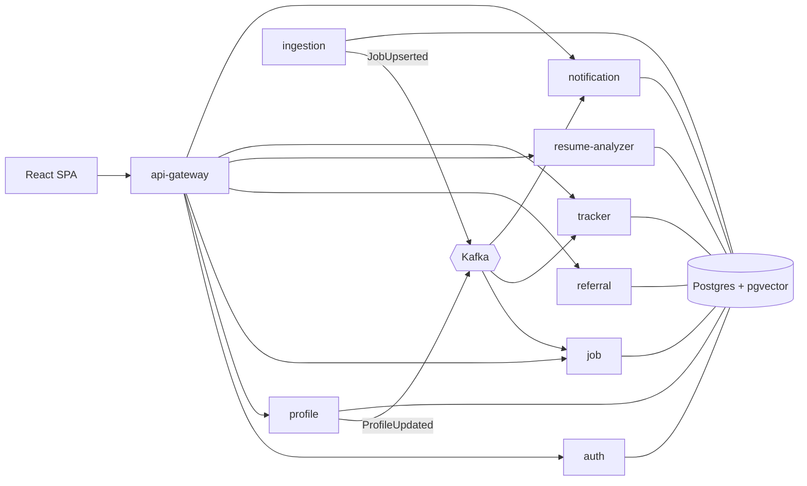

# ReferBoard

Referral-first job search for India and remote tech roles: find relevant jobs, see why you match, and get
referred instead of applying cold. ReferBoard drafts outreach; **you** always send it yourself.

- Architecture, schemas and event contracts: [`docs/ARCHITECTURE.md`](docs/ARCHITECTURE.md)
- Stack: Java 21, Spring Boot 3.5, Spring Cloud 2025.0 (Gateway, Eureka), PostgreSQL 16 + pgvector, Kafka,
  Redis, React 18 + TypeScript + Vite.



## Build status (Phase 1)

| Module | Status | Tests |
|---|---|---|
| event-contracts | ✅ | contract round-trip + forward compatibility |
| common-lib | ✅ | correlation-id sanitising |
| test-support | ✅ | (fixtures: Postgres+pgvector, test JWTs) |
| skills | ✅ | 7 — aliases (K8s→Kubernetes), ambiguous words ("Go", "Excel"), extraction offsets |
| ai-client | ✅ | 9 — Claude/OpenAI request shape, retries on 429/5xx/529, no retry on 4xx, embeddings |
| discovery-server | ✅ | boots, health UP |
| auth-service | ✅ | 15 unit + 7 integration (real Postgres, embedded Kafka) |
| profile-service | ✅ | 21 unit + 5 integration (real PDF/DOCX → parse → pgvector → Kafka; concurrent-onboarding race) |
| ingestion-service | ✅ | 54 unit + 2 integration (4 simulated runs over 61 days against mock ATS APIs; force-republish) |
| job-service | ✅ | 5 unit + 4 integration (events → FTS/trigram/pgvector search, Redis cache, matches, DLT, digest) |
| referral-service | ✅ | 34 unit + 5 integration (Feign → mock job/profile/Claude APIs, draft guard, pipeline events, reminders on a movable clock) |
| resume-analyzer-service | ⏳ | |
| tracker-service | ⏳ next | |
| notification-service | ⏳ | |
| api-gateway | ⏳ | |
| frontend | ⏳ | |

## Run locally with Docker

```bash
cp .env.example .env          # defaults work for local; add GOOGLE_CLIENT_ID to enable Google sign-in
docker compose up --build     # postgres+pgvector, redis, kafka, eureka, and every built service
docker compose --profile tools up kafka-ui   # optional Kafka UI on :8090
```

| URL | What |
|---|---|
| http://localhost:8761 | Eureka dashboard |
| http://localhost:8081/swagger-ui.html | auth-service API docs |
| http://localhost:8081/.well-known/jwks.json | public signing keys |
| http://localhost:8082/swagger-ui.html | profile-service API docs |
| http://localhost:8083/swagger-ui.html | job-service API docs (search, detail + match breakdown, recommendations) |
| http://localhost:8084/swagger-ui.html | ingestion admin API (ADMIN role) |
| http://localhost:8085/swagger-ui.html | referral-service API docs (people to reach, drafts, CRM, reminders) |

Try it:

```bash
curl -i -X POST localhost:8081/api/auth/signup -H 'Content-Type: application/json' \
  -d '{"email":"you@example.com","password":"Passw0rdOK","fullName":"You"}'
# → 201, body has accessToken; refresh token is in the rb_refresh httpOnly cookie
curl localhost:8081/api/auth/me -H "Authorization: Bearer <accessToken>"

# upload a resume (PDF/DOCX/DOC/TXT ≤ 5 MB); parsing runs in the background
curl -X POST localhost:8082/api/profile/resumes -H "Authorization: Bearer <accessToken>" -F "file=@my-cv.pdf"
curl localhost:8082/api/profile/resumes/<id> -H "Authorization: Bearer <accessToken>"   # until parseStatus=PARSED
curl localhost:8082/api/profile -H "Authorization: Bearer <accessToken>"                # structured profile

# jobs: search with filters, each result carries your live match %
curl "localhost:8083/api/jobs?location=Bangalore&q=kafka&postedWithinDays=14" -H "Authorization: Bearer <accessToken>"
curl "localhost:8083/api/jobs/recommended" -H "Authorization: Bearer <accessToken>"
curl "localhost:8083/api/jobs/<jobId>/match" -H "Authorization: Bearer <accessToken>"     # score breakdown
```

### AI providers (optional)

Everything runs without API keys. With none set, resumes are parsed by a deterministic heuristic parser and
embeddings use a local hashing model, so matching works but is cruder, and the profile is marked
`parseSource: HEURISTIC` so the UI asks the user to review it. Add keys to `.env` for the real thing:

| Setting | Effect |
|---|---|
| `ANTHROPIC_API_KEY` | resume (and later JD) parsing and message drafting with Claude (`ANTHROPIC_MODEL`, default `claude-sonnet-5-5`) |
| `OPENAI_API_KEY` | embeddings (`text-embedding-3-small`, 1536-d); also used for parsing if no Anthropic key |
| `LLM_PROVIDER` / `EMBEDDING_PROVIDER` | force `anthropic`/`openai`/`none` and `openai`/`hashing` instead of `auto` |

After adding a key, `POST /api/profile/resumes/{id}/reparse` re-parses an existing resume.

## Run tests

```bash
mvn verify                    # unit tests + integration tests (Testcontainers starts pgvector/pgvector:pg16)
mvn test                      # unit tests only
mvn verify -Dit.db=local      # integration tests against a local Postgres instead of Docker
#   uses IT_DB_URL (default jdbc:postgresql://localhost:5432/), IT_DB_USER/IT_DB_PASSWORD (postgres/postgres);
#   needs the pgvector extension installed; a throwaway database is created and dropped per run
```

Kafka in integration tests is Spring Kafka's embedded KRaft broker (no Docker needed).

## Run a service from your IDE

Start infrastructure only: `docker compose up postgres kafka redis discovery-server`, then run the service's
`*Application` class. Defaults point at `localhost`; Kafka's host listener is `localhost:29092`, so set
`KAFKA_BOOTSTRAP_SERVERS=localhost:29092` in the run configuration.

## Environment variables

All configuration is via environment variables; see [`.env.example`](.env.example) for the full list with
comments. The ones that matter today:

| Variable | Used by | Notes |
|---|---|---|
| `JWT_PRIVATE_KEY` / `JWT_PUBLIC_KEY` | auth-service | PEM or base64 PEM. Empty locally ⇒ generated once into the `authkeys` volume. **Required in production.** |
| `JWT_ISSUER`, `JWT_AUDIENCE` | all services | must match between auth-service and verifiers |
| `GOOGLE_CLIENT_ID` | auth-service | empty ⇒ `/api/auth/google` returns 503 |
| `AUTH_COOKIE_SECURE` | auth-service | keep `true`; browsers accept Secure cookies on `http://localhost` |
| `DB_URL`, `DB_USERNAME`, `DB_PASSWORD` | each service | each service has its own role and schema (see `docker/postgres/init.sql`) |
| `KAFKA_BOOTSTRAP_SERVERS` | each service | |
| `EUREKA_URL` | each service | |
| `LOG_FORMAT` | each service | `ecs` for structured JSON logs; empty for plain text |

## How the referral assistant works

ReferBoard never visits LinkedIn and never sends anything. For a job, `GET /api/referrals/jobs/{jobId}/suggestions`
returns the kinds of people worth reaching (recruiters, engineering managers, people in the same role, alumni of your
college, people who share a past employer), each with a LinkedIn people-search link that you open yourself. You add
the people you choose as contacts (name, profile URL and/or headline; the URL is validated as text, never fetched).

`POST /api/referrals/contacts/{id}/drafts` writes a connection note (≤300 characters, LinkedIn's limit) and a
referral request, each in a WARM and a CONCISE tone, or follow-ups (`{"type":"FOLLOW_UP"}`). Drafts use only facts
from your profile and the job:

- With an `ANTHROPIC_API_KEY` (or OpenAI) the LLM drafts; every draft is then checked. A note over 300 characters is
  shortened at a sentence boundary; a draft containing a **number that isn't in your resume or the job** (an invented
  metric, team size or years of experience) or a placeholder like `[Name]` is replaced with the template draft. The
  response says how many were replaced.
- Without a key, or past `REFERRAL_MAX_AI_DRAFTS_PER_DAY` (default 120 per user per day), template drafts are built
  from the same facts. Achievements are resume bullets quoted verbatim.

You record what you did by moving the contact: `NOT_CONTACTED → REQUEST_SENT → CONNECTED → REFERRAL_ASKED → REFERRED`,
with `NO_RESPONSE` from any contacted state (and back, if they reply). Each status gets a timestamp and a history row,
and publishes `referral.status-changed.v1`. Two reminders are scheduled automatically and fire only if the contact is
still in that status: *connected 2 days ago → send your referral message* and *no reply 5 days after asking → follow
up* (`referral.reminder-due.v1`, with a drafted message; notification-service will email them). Tune with
`REFERRAL_SEND_REFERRAL_AFTER` / `REFERRAL_FOLLOW_UP_AFTER` (ISO-8601 durations).

## Adding skills to the taxonomy

Skill names are normalised everywhere (profiles, jobs, JD analysis) through
`platform/skills/src/main/resources/referboard/skills.yml`. Add an entry with its aliases; words that are also
ordinary English ("Go", "Excel", "Spring") go under `strict:` so they only match when written exactly that way in
free text. `SkillTaxonomyTest` fails on alias collisions.

## Adding companies to the job seed list

Boards are listed in `services/ingestion-service/src/main/resources/companies.yml` (214 to start) and synced into
`ingestion.sources` on every startup. Editing the file never resets a source's health history.

```yaml
companies:
  - { name: "Razorpay", ats: GREENHOUSE, slug: razorpaysoftwareprivatelimited }
  - { name: "CRED", ats: LEVER, slug: cred }
  - { name: "Notion", ats: ASHBY, slug: notion }
  - { name: "Paused Co", ats: ASHBY, slug: paused, enabled: false }   # stop fetching, keep history
```

The slug is the board token in the public careers URL: `boards.greenhouse.io/<slug>`, `jobs.lever.co/<slug>`,
`jobs.ashbyhq.com/<slug>`. To point at your own list without rebuilding, set `INGESTION_SEED_FILE=file:/path/companies.yml`.

**Checking the list:** slugs drift as companies rename boards or switch ATS. A board answering 404 is marked
`NOT_FOUND`, skipped, and re-checked weekly. After a run, list the ones to fix:

```bash
curl localhost:8084/api/ingestion/sources?status=NOT_FOUND -H "Authorization: Bearer <ADMIN token>"
curl -X POST localhost:8084/api/ingestion/runs -H "Authorization: Bearer <ADMIN token>"   # run now
```

**How ingestion behaves** (details in `docs/ARCHITECTURE.md`):

- Only documented public APIs are called (Greenhouse, Lever, Ashby board APIs and Adzuna), never sites whose
  terms prohibit it. robots.txt is honored per host; if it can't be read, the host isn't fetched.
- Requests are rate-limited per host (default 2/s), and 429/5xx/network errors are retried with exponential
  backoff. One failing board never fails the run.
- Postings are kept if they're in India, or remote and open to India, and are tech roles. Duplicates across sources
  (same company + normalized title + location) merge into one job, and the ATS copy wins over Adzuna's snippet.
- A job closes when its board was read successfully but hasn't listed it for 7 days, so a board outage closes
  nothing. Jobs listed for 60+ days are flagged "possible ghost job".
- Re-running is safe: unchanged postings produce no events.
- **Rebuilding a downstream service** (e.g. a fresh job-service database after Kafka retention expired):
  `POST /api/ingestion/runs?forceRepublish=true` re-publishes every currently listed posting.

## Operations: granting ADMIN

There's no self-service admin signup. Promote an existing account in the database, then sign in again so the new
token carries the role:

```sql
update auth.users set role = 'ADMIN' where email = 'you@example.com';
```

## Deployment notes

- Build images with `docker/service.Dockerfile` (`--build-arg MODULE=services/<name>`); images run as non-root,
  in UTC, with layered jars.
- Provide real JWT keys, distinct DB passwords per service role, and `LOG_FORMAT=ecs`.
- Every service exposes `/actuator/health/liveness` and `/actuator/health/readiness` for orchestrator probes.
- Postgres needs the `vector` and `pg_trgm` extensions (`docker/postgres/init.sql` shows the bootstrap).
