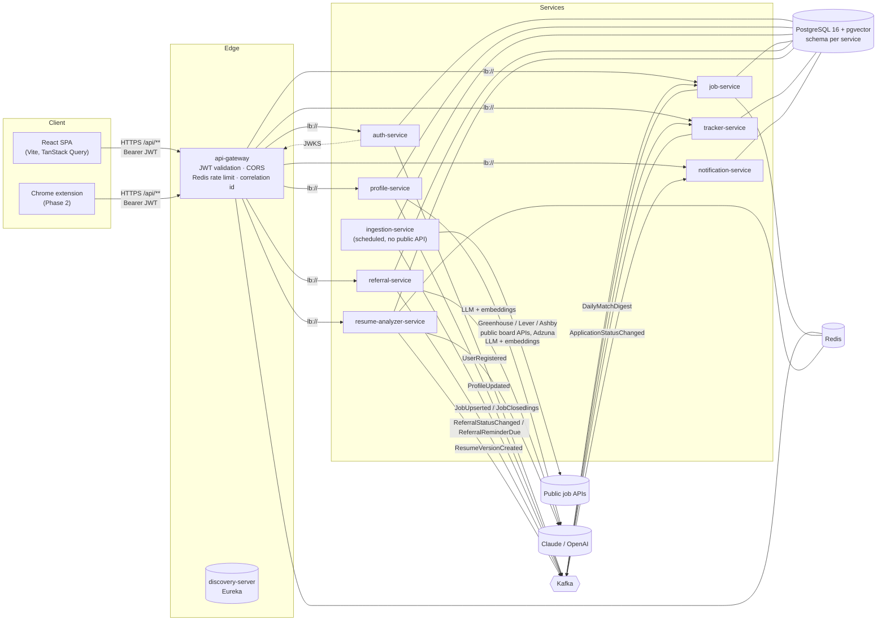

# ReferBoard — Architecture

ReferBoard helps job seekers (India + remote tech roles) find relevant jobs and get **referred** rather than
apply cold. This document is the source of truth for service boundaries, data ownership, schemas and event
contracts. Each service's Flyway `V1__*.sql` is the executable form of its schema below.

## 1. System overview



### Request path

1. SPA calls `/api/...` on the gateway with `Authorization: Bearer <access JWT>`.
2. Gateway assigns/propagates `X-Correlation-Id`, validates the JWT against auth-service's JWKS, applies the
   Redis token-bucket rate limit (keyed by user id, or IP for anonymous routes), and routes via Eureka.
3. The target service validates the JWT again (defence in depth), scopes every query by `sub` (user id), and
   returns either data or the shared `ApiError` body.
4. State changes that other services care about are written to that service's **outbox** in the same
   transaction, then relayed to Kafka.

## 2. Key decisions

| Decision | Choice | Why |
|---|---|---|
| Token signing | **RS256**, keys only in auth-service, public keys at `/.well-known/jwks.json` | Other services can verify but never mint tokens; key rotation is a JWKS change, not a redeploy of every service. |
| Refresh tokens | Opaque 256-bit, stored as SHA-256, **httpOnly + SameSite=Strict cookie** scoped to `/api/auth`, rotated on every use, reuse ⇒ whole family revoked | XSS can't read it; a stolen-and-replayed token kills the attacker's and victim's session together (OAuth 2.0 Security BCP §4.14). |
| Google login | Frontend gets an **ID token** from Google Identity Services; backend verifies signature/iss/aud/exp/`email_verified` | Stateless (no OAuth session through the gateway); the same endpoint serves the Phase 2 extension. |
| Data isolation | One Postgres DB, **one schema + one DB role per service**; roles have no grants on other schemas | "Services never read each other's tables" is enforced by Postgres permissions, while ops stays one instance. Splitting to separate instances later is a connection-string change. |
| Messaging | **Kafka**, one event type per topic, versioned topic names, JSON payloads, key = userId or jobId | Per-entity ordering; consumers deserialize straight into a record; breaking changes ship as `*.v2`. |
| Reliable publishing | **Transactional outbox** (common-lib) + relay with `FOR UPDATE SKIP LOCKED` | No lost events when Kafka is down; no phantom events on rollback; safe with multiple replicas. |
| Idempotent consumers | `processed_events(event_id)` insert-if-absent inside the consumer transaction | At-least-once delivery becomes effectively-once processing. |
| Embeddings | pgvector `vector(1536)`, HNSW index, cosine distance | Matching runs in SQL next to the filters; no extra vector DB. |
| Timezone | All JVMs and DB sessions in **UTC**; UI renders in `Asia/Kolkata` or the user's zone | Also avoids PostgreSQL rejecting the legacy JVM id `Asia/Calcutta`. |
| Tracker | Kept as its own service | resume-analyzer and referral both feed it via events; analytics in Phase 3 reads from it. |

## 3. Maven module structure

```
referboard/                         parent POM (Spring Boot 3.5.x, Spring Cloud 2025.0.x, Java 21)
├── platform/
│   ├── event-contracts/            Topics + event records (no Spring dependency)
│   ├── common-lib/                 auto-config: ApiError + global handler, correlation id filter,
│   │                               JWT resource-server defaults, outbox publisher/relay, processed-event store
│   └── test-support/               PostgreSQL+pgvector for ITs (Testcontainers, or a local server)
├── infrastructure/
│   ├── discovery-server/           Eureka
│   └── api-gateway/                Spring Cloud Gateway (reactive)
├── services/
│   ├── auth-service/               :8081
│   ├── profile-service/            :8082
│   ├── job-service/                :8083
│   ├── ingestion-service/          :8084
│   ├── referral-service/           :8085
│   ├── resume-analyzer-service/    :8086
│   ├── tracker-service/            :8087
│   └── notification-service/       :8088
├── frontend/                       React 18 + TS + Vite
├── docker/                         service.Dockerfile, postgres/init.sql
└── docker-compose.yml
```

Each service: `config/ → web/ (controllers, dto/) → service/ → repository/ → domain/`, MapStruct mappers in
`mapper/`, Flyway in `src/main/resources/db/migration`. Unit tests (`*Test`) run in Surefire; integration tests
(`*IT`) run in Failsafe against real PostgreSQL (Testcontainers by default, `-Dit.db=local` for a local server)
and embedded Kafka.

## 4. Database schemas

Conventions for every schema: UUID primary keys, `created_at`/`updated_at timestamptz`, soft delete via
`deleted_at` where users can delete things, `version` for optimistic locking on contended rows, and the two
shared tables:

```sql
outbox_events    (id uuid pk, topic, message_key, event_type, payload jsonb, created_at, published_at, attempts, last_error)
                 -- partial index on created_at where published_at is null
processed_events (event_id uuid pk, topic, processed_at)
```

### 4.1 `auth` — auth-service ✅ implemented

```sql
users (
  id uuid pk, email varchar(320), password_hash varchar(100) null,  -- null for Google-only accounts
  full_name, avatar_url, auth_provider ('LOCAL'|'GOOGLE'), google_subject null,
  email_verified bool, role ('USER'|'ADMIN'), status ('ACTIVE'|'DISABLED'),
  failed_login_attempts int, locked_until, last_login_at,
  created_at, updated_at, deleted_at, version)
  unique (lower(email)) where deleted_at is null
  unique (google_subject) where google_subject is not null

refresh_tokens (
  id uuid pk, user_id fk→users, token_hash varchar(64) unique, family_id uuid,
  expires_at, revoked_at, replaced_by uuid, user_agent, ip_address, created_at)
  index (user_id), (family_id), (expires_at)
```

### 4.2 `profile` — profile-service

```sql
resumes (
  id, user_id, file_name, content_type, size_bytes, sha256, storage_key,      -- file lives on disk/S3
  extracted_text text, parse_status ('PENDING'|'PARSED'|'FAILED'), parse_error,
  is_primary bool, created_at, updated_at, deleted_at)
  index (user_id) where deleted_at is null; unique (user_id) where is_primary and deleted_at is null

profiles (
  user_id pk, headline, summary, current_title, current_company, location,
  total_experience_years numeric(4,1), college, highest_degree,
  profile_version bigint,                          -- bumped on every change, carried in ProfileUpdated
  embedding vector(1536), embedding_model, created_at, updated_at)

profile_skills (id, user_id, name, normalized_name, years numeric(4,1), source ('PARSED'|'USER'),
  evidence ('BULLET'|'SKILLS_LIST'), created_at)
  unique (user_id, normalized_name)

experiences (id, user_id, company, title, location, start_date, end_date, is_current,
  description, bullets jsonb, sort_order, created_at, updated_at)
  index (user_id, sort_order)

educations (id, user_id, institution, degree, field_of_study, start_year, end_year, grade, sort_order)

job_preferences (user_id pk, roles text[], locations text[], remote_only bool, open_to_remote bool,
  min_salary_inr bigint, experience_level ('INTERN'|'ENTRY'|'MID'|'SENIOR'|'LEAD'|'PRINCIPAL'),
  updated_at)
```

### 4.3 `ingestion` — ingestion-service

```sql
company_sources (id, slug, name, ats_type ('GREENHOUSE'|'LEVER'|'ASHBY'), enabled,
  last_fetched_at, last_status, last_error, consecutive_failures, created_at, updated_at)
  unique (ats_type, slug)                         -- seeded from companies.yml on startup

ingestion_runs (id, source, started_at, finished_at, status ('RUNNING'|'SUCCEEDED'|'PARTIAL'|'FAILED'),
  fetched int, created int, updated int, unchanged int, closed int, errors jsonb)

ingested_postings (
  job_id uuid pk,                                 -- = UUID.nameUUIDFromBytes(dedup_key)
  dedup_key unique,                               -- lower(company)|normalized title|normalized location
  source, source_job_id, company_slug, content_hash,
  posted_at, first_seen_at, last_seen_at, closed_at,
  continuous_since timestamptz,                   -- start of the current unbroken listing window
  ghost_job_suspected bool, created_at, updated_at)
  index (last_seen_at) where closed_at is null    -- 7-day close sweep
```

### 4.4 `job` — job-service

```sql
companies (id, slug unique, name, logo_url, website, created_at, updated_at)

jobs (
  id uuid pk,                                     -- jobId from ingestion (deterministic)
  dedup_key unique, source, source_job_id, company_id fk, company_name,
  title, normalized_title, location, country, remote bool, employment_type, seniority, department,
  description_html, description_text, apply_url,
  salary_min, salary_max, salary_currency,
  posted_at, first_seen_at, last_seen_at, status ('OPEN'|'CLOSED'), closed_at,
  ghost_job_suspected bool, content_hash,
  embedding vector(1536), embedding_model,
  search_tsv tsvector generated always as (
     setweight(to_tsvector('english', coalesce(title,'')), 'A') ||
     setweight(to_tsvector('english', coalesce(company_name,'')), 'B') ||
     setweight(to_tsvector('english', coalesce(description_text,'')), 'C')) stored,
  created_at, updated_at)
  index gin (search_tsv)
  index (status, posted_at desc)
  index (status, remote, posted_at desc)
  index (lower(location) text_pattern_ops)
  index gin (title gin_trgm_ops)                  -- fuzzy role search
  index hnsw (embedding vector_cosine_ops)

job_skills (job_id fk, skill varchar(100), pk (job_id, skill)); index (skill)

user_match_profiles (                             -- local copy of ProfileUpdated; never reads profile schema
  user_id pk, profile_version, skills text[], experience_years numeric(4,1),
  preferences jsonb, embedding vector(1536), updated_at)

job_matches (
  user_id, job_id fk, score smallint,              -- 0..100 shown as match %
  vector_score real, skill_score real, preference_score real,
  matched_skills text[], missing_skills text[], computed_at, digested_at,
  pk (user_id, job_id))
  index (user_id, score desc)
```

### 4.5 `referral` — referral-service

```sql
job_snapshots (job_id pk, title, company_name, location, skills text[], description_excerpt, fetched_at)

contacts (
  id, user_id, job_id, full_name, profile_url, headline,
  person_type ('RECRUITER'|'ENGINEERING_MANAGER'|'TEAM_MEMBER'|'ALUMNI'|'EX_COLLEAGUE'|'OTHER'),
  status ('NOT_CONTACTED'|'REQUEST_SENT'|'CONNECTED'|'REFERRAL_ASKED'|'REFERRED'|'NO_RESPONSE'),
  request_sent_at, connected_at, referral_asked_at, referred_at, no_response_at,
  notes, created_at, updated_at, deleted_at, version)
  index (user_id, job_id) where deleted_at is null; index (user_id, status)

contact_status_history (id, contact_id fk, from_status, to_status, changed_at)

message_drafts (id, user_id, contact_id fk, kind ('CONNECTION_NOTE'|'REFERRAL_REQUEST'|'FOLLOW_UP'),
  tone ('WARM'|'CONCISE'), content, char_count, model, prompt_version, copied_at, created_at)
  check (kind <> 'CONNECTION_NOTE' or char_count <= 300)

reminders (id, user_id, contact_id fk, type ('SEND_REFERRAL_MESSAGE'|'FOLLOW_UP'), due_at,
  status ('PENDING'|'FIRED'|'DONE'|'DISMISSED'), drafted_follow_up, created_at, fired_at)
  index (status, due_at)
```

### 4.6 `analyzer` — resume-analyzer-service

```sql
parsed_jds (content_hash varchar(64) pk, parsed jsonb, model, prompt_version, hit_count, created_at)
           -- cache: identical JD text never hits the LLM twice

resume_versions (id, user_id, name, job_id null, base_resume_id, source_analysis_id null,
  content jsonb,                                  -- structured resume after accepted suggestions
  file_format ('DOCX'|'PDF'), storage_key, created_at, deleted_at)
  index (user_id, created_at desc)

jd_analyses (
  id, user_id, job_id null, jd_text, jd_hash, parsed_jd jsonb,
  resume_version_id null, resume_source ('PROFILE_RESUME'|'UPLOAD'|'VERSION'), resume_ref_id,
  score smallint, verdict ('STRONG'|'GOOD'|'PARTIAL'|'WEAK'),
  breakdown jsonb,                                -- per-component score + weight
  matched jsonb, missing jsonb, ats_checks jsonb,
  suggestions jsonb, accepted_suggestions jsonb, projected_score smallint,
  created_at)
  index (user_id, created_at desc); index (user_id, job_id)

usage_counters (user_id, period char(7) /* YYYY-MM */, analyses int, pk (user_id, period))
```

### 4.7 `tracker` — tracker-service

```sql
applications (
  id, user_id, job_id, job_title, company_name, location, apply_url,
  stage ('SAVED'|'APPLIED'|'REFERRAL_REQUESTED'|'REFERRED'|'INTERVIEW'|'OFFER'|'REJECTED'),
  position numeric,                               -- fractional ordering within a Kanban column
  resume_version_id null, applied_at, notes, created_at, updated_at, deleted_at, version)
  unique (user_id, job_id) where deleted_at is null
  index (user_id, stage, position)

application_events (id, application_id fk, type ('STAGE_CHANGED'|'NOTE'|'RESUME_LINKED'|'REFERRAL_UPDATE'),
  from_stage, to_stage, details jsonb, occurred_at)
  index (application_id, occurred_at)

resume_links_pending (user_id, job_id, resume_version_id, created_at, pk (user_id, job_id))
  -- ResumeVersionCreated can arrive before the application card exists
```

### 4.8 `notification` — notification-service

```sql
recipients (user_id pk, email, full_name, email_opt_in bool, digest_enabled bool,
  timezone default 'Asia/Kolkata', created_at, updated_at)       -- filled from UserRegistered

notifications (id, user_id, type, title, body, link, data jsonb, read_at, created_at)
  index (user_id, created_at desc); index (user_id) where read_at is null

email_deliveries (id, user_id, notification_id null, template, to_address, subject,
  provider, provider_message_id, status ('QUEUED'|'SENT'|'FAILED'), attempts, last_error,
  dedup_key unique,                               -- e.g. digest:{userId}:{date} — never double-send
  created_at, sent_at)
```

## 5. Kafka event contracts

Source: `platform/event-contracts`. Every payload embeds `metadata`:

```json
{ "eventId": "uuid", "eventType": "ProfileUpdated", "schemaVersion": 1,
  "occurredAt": "2026-10-13T10:00:00Z", "producer": "profile-service", "correlationId": "…" }
```

| Topic | Producer → Consumers | Key | Payload (besides `metadata`) |
|---|---|---|---|
| `user.registered.v1` | auth → notification | userId | userId, email, fullName, authProvider |
| `profile.updated.v1` | profile → job, analyzer | userId | userId, profileVersion, headline, skills[], totalExperienceYears, college, pastCompanies[], preferences{roles[], locations[], remoteOnly, openToRemote, minSalaryInr, experienceLevel}, embedding[], embeddingModel, embeddingDimensions |
| `job.upserted.v1` | ingestion → job | jobId | jobId, dedupKey, source, sourceJobId, companyName, companySlug, title, normalizedTitle, location, country, remote, employmentType, seniority, departmentName, descriptionHtml, descriptionText, applyUrl, salaryMin/Max/Currency, postedAt, firstSeenAt, lastSeenAt, skills[], embedding[], embeddingModel, ghostJobSuspected, contentHash |
| `job.closed.v1` | ingestion → job | jobId | jobId, closedAt, reason (`UNSEEN_7_DAYS`) |
| `match.daily-digest.v1` | job → notification | userId | userId, digestDate, matches[≤10]{jobId, title, companyName, location, remote, matchPercent, matchedSkills[]} |
| `referral.status-changed.v1` | referral → tracker | userId | userId, jobId, contactId, contactName, previousStatus, newStatus, changedAt |
| `referral.reminder-due.v1` | referral → notification | userId | reminderId, userId, contactId, jobId, contactName, jobTitle, companyName, reminderType, message, draftedFollowUp, dueAt |
| `resume.version-created.v1` | analyzer → tracker | userId | userId, resumeVersionId, versionName, jobId, analysisId, scoreBefore, scoreAfter, fileFormat |
| `application.status-changed.v1` | tracker → notification, (Phase 3 analytics) | userId | userId, applicationId, jobId, previousStage, newStage, resumeVersionId, changedAt |

**Compatibility rules:** consumers ignore unknown fields (`@JsonIgnoreProperties(ignoreUnknown = true)`, covered
by `EventContractsTest`); adding optional fields keeps the topic; removing/renaming fields or changing meaning
requires a new `.v2` topic, with the producer dual-writing until consumers migrate.

**Delivery:** at-least-once (outbox relay) → consumers de-duplicate on `eventId`. `ProfileUpdated` and
`JobUpserted` also carry a version/hash so stale or unchanged updates are skipped.

## 6. Security model

- Access token: RS256 JWT, 15 min. Claims: `iss`, `aud=["referboard"]`, `sub`=user UUID, `email`, `name`,
  `roles`, `jti`, `iat`, `nbf`, `exp`.
- Refresh token: 30 days, cookie `rb_refresh` (`HttpOnly; SameSite=Strict; Path=/api/auth; Secure`).
- Password: bcrypt via `DelegatingPasswordEncoder` (`{bcrypt}` prefix allows upgrading the algorithm later;
  hashes are upgraded on login). 8–72 chars, letter + digit.
- Brute force: 5 failures → 15 min lockout per account (auth-service) + per-IP rate limit (gateway).
- Unknown-email logins spend the same bcrypt time as real ones (no timing oracle).
- Every service re-validates the JWT and scopes data by `sub`; IDs in paths are always checked against the
  owner.
- Swagger, `/actuator/health/**` and JWKS are the only unauthenticated non-auth endpoints.

## 7. Cross-cutting

- **Errors:** every service returns
  `{timestamp, status, error, code, message, path, correlationId, fieldErrors[]}`; the frontend switches on `code`.
- **Correlation ID:** gateway sets `X-Correlation-Id`; services put it in the MDC (`%X{correlationId}` in logs),
  echo it on responses, copy it into event metadata and Kafka headers; consumers restore it. Structured JSON
  logs via `LOG_FORMAT=ecs`.
- **Health:** Actuator liveness/readiness probes on every service.
- **API docs:** springdoc per service; the gateway aggregates `/v3/api-docs` of each route into one Swagger UI.
- **Hard constraints:** no scraping of LinkedIn/Naukri/Indeed or any site whose terms prohibit it; ingestion
  only calls documented public board APIs and Adzuna. No automated LinkedIn actions; the app only drafts text and
  builds search URLs the user opens. Resume tailoring only rephrases/reorders existing content; any skill not
  present in the resume is flagged "Add only if you have this experience" and needs explicit confirmation.
