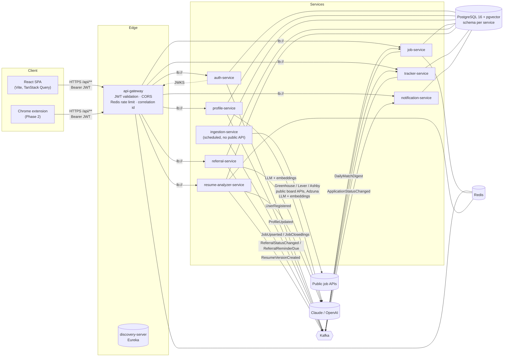

# ReferBoard — Architecture

ReferBoard helps job seekers (India + remote tech roles) find relevant jobs and get **referred** rather than
apply cold. This document is the source of truth for service boundaries, data ownership, schemas and event
contracts. Each service's Flyway `V1__*.sql` is the executable form of its schema below.

## 1. System overview



### Request path

1. SPA calls `/api/...` on the gateway with `Authorization: Bearer <access JWT>`.
2. Gateway assigns/propagates `X-Correlation-Id`, validates the JWT against auth-service's JWKS, applies the
   Redis token-bucket rate limit (keyed by user id, or IP for anonymous routes), and routes via Eureka.
3. The target service validates the JWT again (defence in depth), scopes every query by `sub` (user id), and
   returns either data or the shared `ApiError` body.
4. State changes that other services care about are written to that service's **outbox** in the same
   transaction, then relayed to Kafka.

## 2. Key decisions

| Decision | Choice | Why |
|---|---|---|
| Token signing | **RS256**, keys only in auth-service, public keys at `/.well-known/jwks.json` | Other services can verify but never mint tokens; key rotation is a JWKS change, not a redeploy of every service. |
| Refresh tokens | Opaque 256-bit, stored as SHA-256, **httpOnly + SameSite=Strict cookie** scoped to `/api/auth`, rotated on every use, reuse ⇒ whole family revoked | XSS can't read it; a stolen-and-replayed token kills the attacker's and victim's session together (OAuth 2.0 Security BCP §4.14). |
| Google login | Frontend gets an **ID token** from Google Identity Services; backend verifies signature/iss/aud/exp/`email_verified` | Stateless (no OAuth session through the gateway); the same endpoint serves the Phase 2 extension. |
| Data isolation | One Postgres DB, **one schema + one DB role per service**; roles have no grants on other schemas | "Services never read each other's tables" is enforced by Postgres permissions, while ops stays one instance. Splitting to separate instances later is a connection-string change. |
| Messaging | **Kafka**, one event type per topic, versioned topic names, JSON payloads, key = userId or jobId | Per-entity ordering; consumers deserialize straight into a record; breaking changes ship as `*.v2`. |
| Reliable publishing | **Transactional outbox** (common-lib) + relay with `FOR UPDATE SKIP LOCKED` | No lost events when Kafka is down; no phantom events on rollback; safe with multiple replicas. |
| Idempotent consumers | `processed_events(event_id)` insert-if-absent inside the consumer transaction | At-least-once delivery becomes effectively-once processing. |
| Embeddings | pgvector `vector(1536)`, HNSW index, cosine distance | Matching runs in SQL next to the filters; no extra vector DB. |
| LLM access | `ai-client` module: forced tool call (Claude) / `json_schema` (OpenAI) for structured output, retry on 429/5xx/529 only | Output is schema-checked JSON, not free text to regex. Every LLM feature has a deterministic fallback, so the platform works keyless and degrades instead of failing. Prompts treat user documents as data. |
| Skill vocabulary | One taxonomy (`skills.yml`) shared by profile, jobs and the analyzer | "K8s" on a resume and "Kubernetes" in a JD must be the same skill everywhere, or match scores lie. |
| Timezone | All JVMs and DB sessions in **UTC**; UI renders in `Asia/Kolkata` or the user's zone | Also avoids PostgreSQL rejecting the legacy JVM id `Asia/Calcutta`. |
| Tracker | Kept as its own service | resume-analyzer and referral both feed it via events; analytics in Phase 3 reads from it. |

## 3. Maven module structure

```
referboard/                         parent POM (Spring Boot 3.5.x, Spring Cloud 2025.0.x, Java 21)
├── platform/
│   ├── event-contracts/            Topics + event records (no Spring dependency)
│   ├── common-lib/                 auto-config: ApiError + global handler, correlation id filter,
│   │                               JWT resource-server (JWKS + iss + aud), outbox publisher/relay,
│   │                               processed-event store
│   ├── skills/                     skill taxonomy: canonical names, aliases, extraction from free text
│   ├── ai-client/                  LlmClient (Claude / OpenAI structured output), EmbeddingClient,
│   │                               retries, offline fallbacks
│   └── test-support/               PostgreSQL+pgvector for ITs (Testcontainers or local), TestJwt
├── infrastructure/
│   ├── discovery-server/           Eureka
│   └── api-gateway/                Spring Cloud Gateway (reactive)
├── services/
│   ├── auth-service/               :8081
│   ├── profile-service/            :8082
│   ├── job-service/                :8083
│   ├── ingestion-service/          :8084
│   ├── referral-service/           :8085
│   ├── resume-analyzer-service/    :8086
│   ├── tracker-service/            :8087
│   └── notification-service/       :8088
├── frontend/                       React 18 + TS + Vite
├── docker/                         service.Dockerfile, postgres/init.sql
└── docker-compose.yml
```

Each service: `config/ → web/ (controllers, dto/) → service/ → repository/ → domain/`, MapStruct mappers in
`mapper/`, Flyway in `src/main/resources/db/migration`. Unit tests (`*Test`) run in Surefire; integration tests
(`*IT`) run in Failsafe against real PostgreSQL (Testcontainers by default, `-Dit.db=local` for a local server)
and embedded Kafka.

## 4. Database schemas

Conventions for every schema: UUID primary keys, `created_at`/`updated_at timestamptz`, soft delete via
`deleted_at` where users can delete things, `version` for optimistic locking on contended rows, and the two
shared tables:

```sql
outbox_events    (id uuid pk, topic, message_key, event_type, payload jsonb, created_at, published_at, attempts, last_error)
                 -- partial index on created_at where published_at is null
processed_events (event_id uuid pk, topic, processed_at)
```

### 4.1 `auth` — auth-service ✅ implemented

```sql
users (
  id uuid pk, email varchar(320), password_hash varchar(100) null,  -- null for Google-only accounts
  full_name, avatar_url, auth_provider ('LOCAL'|'GOOGLE'), google_subject null,
  email_verified bool, role ('USER'|'ADMIN'), status ('ACTIVE'|'DISABLED'),
  failed_login_attempts int, locked_until, last_login_at,
  created_at, updated_at, deleted_at, version)
  unique (lower(email)) where deleted_at is null
  unique (google_subject) where google_subject is not null

refresh_tokens (
  id uuid pk, user_id fk→users, token_hash varchar(64) unique, family_id uuid,
  expires_at, revoked_at, replaced_by uuid, user_agent, ip_address, created_at)
  index (user_id), (family_id), (expires_at)
```

### 4.2 `profile` — profile-service ✅ implemented

```sql
resumes (
  id, user_id, file_name, content_type, size_bytes, sha256, storage_key,      -- file on disk / S3
  extracted_text, parse_status ('PENDING'|'PARSED'|'FAILED'), parse_error,
  parser ('LLM'|'HEURISTIC'), parser_model, parsed_json jsonb, parsed_at,      -- raw parse kept for the analyzer
  is_primary, created_at, updated_at, deleted_at)
  index (user_id, created_at desc) where deleted_at is null
  unique (user_id) where is_primary and deleted_at is null                     -- one primary per user

profiles (
  user_id pk, full_name, email, phone, headline, summary, current_title, current_company, location,
  total_experience_years numeric(4,1),            -- computed from dated roles, overlaps merged; never from the LLM
  college, highest_degree, links jsonb, certifications jsonb,
  parse_source ('LLM'|'HEURISTIC'|'MANUAL'), primary_resume_id,
  profile_version bigint,                          -- bumped on every change, carried in ProfileUpdated
  embedding vector(1536), embedding_model, embedding_version,   -- embedding_version = profile_version it encodes
  created_at, updated_at, version)

profile_skills (id, user_id fk, name /* canonical */, display_name, years numeric(4,1),
  source ('PARSED'|'USER'), evidence ('BULLET'|'SKILLS_LIST'), sort_order, created_at)
  unique (user_id, name)

experiences (id, user_id fk, company, title, location, start_date, end_date, is_current,
  description, bullets jsonb, sort_order, created_at, updated_at)
  index (user_id, sort_order)

educations (id, user_id fk, institution, degree, field_of_study, start_year, end_year, grade, sort_order)

job_preferences (user_id pk, roles jsonb, locations jsonb, remote_only, open_to_remote,
  min_salary_inr bigint, experience_level ('INTERN'|'ENTRY'|'MID'|'SENIOR'|'LEAD'|'PRINCIPAL'), updated_at)
```

**Resume pipeline:** upload (type sniffed from bytes, not the extension; SHA-256 de-dup; 10 per user) → 202 →
after commit, async: Tika text extraction → LLM parse with a JSON schema (or heuristic fallback) → stored → if
primary, the profile's resume-derived parts are rebuilt (experiences, education, PARSED skills); USER skills and
preferences are kept. **Sync:** after every profile commit the embedding is computed outside any transaction,
then stored and `ProfileUpdated` published in one transaction *only if `profile_version` is unchanged*, so a
burst of edits never publishes a stale event.

### 4.3 `ingestion` — ingestion-service ✅ implemented

```sql
sources (                                         -- one row per fetchable thing
  source_key pk,                                  -- greenhouse:acme · lever:acme · ashby:acme · adzuna:in:<query> · sample:demo
  source_type ('GREENHOUSE'|'LEVER'|'ASHBY'|'ADZUNA'|'SAMPLE'), slug, display_name, enabled,
  status ('NEW'|'OK'|'FAILING'|'NOT_FOUND'|'BLOCKED'),
  last_attempt_at, last_success_at, last_error, consecutive_failures, last_job_count, created_at, updated_at)
  -- synced from companies.yml + configured Adzuna queries on startup; health survives YAML edits

ingestion_runs (id, trigger_type ('SCHEDULED'|'MANUAL'|'STARTUP'), started_at, finished_at,
  status ('RUNNING'|'SUCCEEDED'|'PARTIAL'|'FAILED'), sources_ok, sources_failed,
  fetched, kept, created, updated, unchanged, closed, errors jsonb)

ingested_postings (
  job_id uuid pk,                                 -- = UUID.nameUUIDFromBytes(dedup_key)
  dedup_key unique,                               -- normalizedCompany | normalizedTitle | locationKey
  source, source_key, source_job_id, company_name, title, location,
  content_hash,                                   -- unchanged hash ⇒ no event
  posted_at, first_seen_at, last_seen_at, closed_at, repost_count, ghost_job_suspected, embedding_model,
  created_at, updated_at)
  index (last_seen_at) where closed_at is null; index (source_key)
```

**Run:** cluster-wide single run (PostgreSQL advisory lock) → due sources fetched with bounded concurrency
through one HTTP client that enforces robots.txt (RFC 9309; unreadable ⇒ don't fetch), a per-host rate limit and
Resilience4j retry on 429/5xx/network errors only (404 ⇒ NOT_FOUND, re-checked weekly) → normalise
(location aliases, remote-open-to-India detection, title/company normalisation, tech-role filter, seniority,
skills) → per-source batch: de-dup, embed only new/changed content, upsert + publish in one transaction →
close stale postings → record run.

**Source priority:** ATS boards (3) > Adzuna (2) > sample (1). A lower-priority copy of a job never overwrites,
touches or reopens one owned by a higher-priority source; the company's own board decides whether it's open.

**Resync:** `POST /api/ingestion/runs?forceRepublish=true` (ADMIN) re-publishes every listed posting, so a
consumer whose data was lost after Kafka retention expired can be rebuilt.

**Closing & ghost jobs:** closed when not seen for 7 days *and* its source was read successfully after it was last
seen (so outages close nothing); flagged `ghostJobSuspected` once first seen ≥ 60 days ago and still listed;
reposts (posted date moving forward) are counted.

### 4.4 `job` — job-service ✅ implemented

job-service uses `JdbcTemplate` rather than JPA: its work is `ON CONFLICT` upserts, pgvector distance and
full-text ranking, all of which JPA would only wrap in native SQL.

```sql
companies (id, slug unique /* normalised name */, name, created_at, updated_at)
  index gin (name gin_trgm_ops)

jobs (
  id uuid pk,                                     -- jobId from ingestion (deterministic from dedup_key)
  dedup_key unique, source, source_job_id, company_id fk, company_name,
  title, normalized_title, location, country, remote, employment_type, seniority, department,
  description_html /* sanitised at ingestion */, description_text, apply_url,
  salary_min, salary_max, salary_currency,
  posted_at, first_seen_at, last_seen_at,
  listed_at,                                      -- coalesce(posted_at, first_seen_at): drives "posted N days ago"
  status ('OPEN'|'CLOSED'), closed_at, ghost_job_suspected, content_hash,
  embedding vector(1536), embedding_model,
  search_tsv tsvector generated always as (title A, company B, description C) stored,
  created_at, updated_at)
  index (status, listed_at desc); (status, remote, listed_at desc); (company_id); (lower(location) text_pattern_ops)
  index gin (search_tsv); gin (title gin_trgm_ops); hnsw (embedding vector_cosine_ops)

job_skills (job_id fk, skill /* canonical */, position, pk (job_id, skill)); index (skill)

user_match_profiles (user_id pk, profile_version, headline, skills jsonb, experience_years,
  preferences jsonb, embedding vector(1536), embedding_model, updated_at)   -- copy of ProfileUpdated

job_matches (user_id, job_id fk, score, semantic_score, skill_score, preference_score,
  matched_skills jsonb, missing_skills jsonb, computed_at, digested_at, pk (user_id, job_id))
  index (user_id, score desc); (computed_at) where digested_at is null

pending_match_jobs (job_id pk fk, queued_at)      -- new/changed jobs awaiting scoring against all users
```

**Search:** filters are `q` (web-search syntax over the weighted tsvector, plus trigram on titles), `role` (every
word must appear in the title, exactly or with per-word trigram similarity ≥ 0.45, so "bakend engineer" finds
backend roles but "backend engineer" never matches "frontend engineer"), `location` (any spelling of a city),
`remote`, `postedWithinDays`, `company`, `seniority`, `skills`, `hideGhostJobs`; sort `RELEVANCE | RECENT | MATCH`;
page/size ≤ 50. The user-independent page is cached in Redis (60 s); match % is overlaid per request. A Redis
outage only costs latency.

**Match score** (`MatchScorer`, pure and unit-tested), 0–100:

| Component | Weight | Computation |
|---|---|---|
| semantic | 45% | cosine(profile, job) in pgvector, same embedding model only; [0.15, 0.70] rescaled to [0, 1] |
| skills | 35% | job skills the user has ÷ min(job skills, 8); also yields matched and missing lists |
| preferences | 20% | mean of: target-role overlap, location/remote fit, seniority distance, salary floor |

A component that can't be computed (no vector, job lists no skills, no preferences) is dropped and the remaining
weights renormalised; the breakdown returned to the UI includes the effective weights and plain-language reasons.
Scores are computed **live** for whatever the user is viewing, and **precomputed** into `job_matches`
(threshold 35, top 300 per user) for recommendations, sort=MATCH and the daily digest: rebuilt from nearest
neighbours + skill overlap when a profile changes, and extended every minute for newly ingested jobs.

**Consumers** are idempotent (processed_events) and transactional; a record that keeps failing is retried with
exponential backoff, then parked on `<topic>.DLT` so it can't block its partition. Stale `ProfileUpdated` versions
are ignored.

**Daily digest:** 08:00 Asia/Kolkata, each user's top ≤ 10 new matches scoring ≥ 60 → `DailyMatchDigest`; a match
appears in at most one digest.

### 4.5 `referral` — referral-service ✅ implemented

```sql
job_snapshots (job_id pk, title, company_name, location, apply_url, skills jsonb, description_excerpt, fetched_at)
user_snapshots (user_id pk, full_name, headline, current_title, current_company, experience_years, college,
  past_companies jsonb, skills jsonb, achievements jsonb /* resume bullets with numbers, verbatim */, fetched_at)

contacts (
  id, user_id, job_id fk → job_snapshots, full_name, profile_url, headline,
  person_type ('RECRUITER'|'ENGINEERING_MANAGER'|'TEAM_MEMBER'|'ALUMNI'|'EX_COLLEAGUE'|'OTHER'),
  status ('NOT_CONTACTED'|'REQUEST_SENT'|'CONNECTED'|'REFERRAL_ASKED'|'REFERRED'|'NO_RESPONSE'),
  request_sent_at, connected_at, referral_asked_at, referred_at, no_response_at,
  notes, created_at, updated_at, deleted_at, version)
  index (user_id, job_id) where deleted_at is null; index (user_id, status) where deleted_at is null

contact_status_history (id, contact_id fk, from_status, to_status, changed_at)

message_drafts (id, user_id, contact_id fk, kind ('CONNECTION_NOTE'|'REFERRAL_REQUEST'|'FOLLOW_UP'),
  tone ('WARM'|'CONCISE'), content, char_count, model /* 'template' or provider:model */, prompt_version,
  copied_at, created_at)
  check (kind <> 'CONNECTION_NOTE' or char_count <= 300)

reminders (id, user_id, contact_id fk, type ('SEND_REFERRAL_MESSAGE'|'FOLLOW_UP'), trigger_status, due_at,
  status ('PENDING'|'FIRED'|'DONE'|'DISMISSED'|'OBSOLETE'), message, drafted_follow_up, created_at, fired_at)
  index (due_at) where status = 'PENDING'; index (user_id, status)

outbox_events, processed_events
```

Implementation notes:

- **Never touches LinkedIn.** Suggestions are LinkedIn people-search URLs built as strings for the user to open;
  pasted profile URLs are normalised (`/in/<slug>`, https, no query) but never requested.
- **Cross-service reads** use OpenFeign (`JobClient`, `ProfileClient`) resolved through Eureka, with the caller's
  JWT and correlation id forwarded by common-lib's `ForwardingFeignInterceptor`. Upstream 404 → our 404; 5xx and
  connection failures → 502 `UPSTREAM_UNAVAILABLE` (a stale snapshot is used instead when one exists).
- **Snapshots** (job 6 h TTL, user 10 min) are upserted with `insert … on conflict`, so the reminder scheduler can draft
  follow-ups with no user token, and concurrent requests can't collide.
- **Drafting:** `DraftFacts` is the only input to both drafters. The LLM (forced JSON schema, prompt treats the facts
  block as data) produces four drafts in one call; `DraftGuard` shortens over-long notes and rejects drafts with a
  number not present in the facts (compared as whole tokens) or a placeholder, substituting `TemplateDrafter`'s
  draft. Per-user daily AI allowance; otherwise templates.
- **Pipeline:** `ContactStatus.allowedTargets()` (forward with skips, one step back, `NO_RESPONSE` from contacted
  states and back, `REFERRED` terminal). A change stamps the status timestamp, writes history, obsoletes pending
  reminders, completes fired ones for the previous status, schedules the next, and publishes through the outbox —
  all in one transaction, guarded by the contact's `@Version`.
- **Reminders:** a scheduled scan locks due rows with `FOR UPDATE SKIP LOCKED` (safe with several instances), fires
  only if the contact is still in `trigger_status`, stores the drafted message as a draft, and publishes
  `ReferralReminderDue`.

### 4.6 `analyzer` — resume-analyzer-service

```sql
parsed_jds (content_hash varchar(64) pk, parsed jsonb, model, prompt_version, hit_count, created_at)
           -- cache: identical JD text never hits the LLM twice

resume_versions (id, user_id, name, job_id null, base_resume_id, source_analysis_id null,
  content jsonb,                                  -- structured resume after accepted suggestions
  file_format ('DOCX'|'PDF'), storage_key, created_at, deleted_at)
  index (user_id, created_at desc)

jd_analyses (
  id, user_id, job_id null, jd_text, jd_hash, parsed_jd jsonb,
  resume_version_id null, resume_source ('PROFILE_RESUME'|'UPLOAD'|'VERSION'), resume_ref_id,
  score smallint, verdict ('STRONG'|'GOOD'|'PARTIAL'|'WEAK'),
  breakdown jsonb,                                -- per-component score + weight
  matched jsonb, missing jsonb, ats_checks jsonb,
  suggestions jsonb, accepted_suggestions jsonb, projected_score smallint,
  created_at)
  index (user_id, created_at desc); index (user_id, job_id)

usage_counters (user_id, period char(7) /* YYYY-MM */, analyses int, pk (user_id, period))
```

### 4.7 `tracker` — tracker-service ✅ implemented

```sql
applications (
  id, user_id, job_id null /* null = job found outside ReferBoard */, job_title, company_name, location, apply_url,
  stage ('SAVED'|'APPLIED'|'REFERRAL_REQUESTED'|'REFERRED'|'INTERVIEW'|'OFFER'|'REJECTED'),
  position double precision,                      -- fractional ordering within a Kanban column
  source ('MANUAL'|'REFERRAL'), resume_version_id, referral_summary, notes,
  applied_at, stage_changed_at, next_action, next_action_at, job_closed_at,
  created_at, updated_at, deleted_at, version)
  unique (user_id, job_id) where deleted_at is null and job_id is not null
  index (user_id, stage, position) where deleted_at is null; index (job_id) where deleted_at is null

application_events (id, seq identity /* timeline order */, application_id fk,
  type ('CREATED'|'STAGE_CHANGED'|'NOTE'|'RESUME_LINKED'|'REFERRAL_UPDATE'|'JOB_CLOSED'|'UPDATED'),
  from_stage, to_stage, message, details jsonb, occurred_at)
  index (application_id, seq)

resume_links_pending (user_id, job_id, resume_version_id, version_name, created_at, pk (user_id, job_id))
  -- ResumeVersionCreated can arrive before the application card exists
closed_jobs (job_id pk, closed_at)                -- JobClosed can too

outbox_events, processed_events
```

Implementation notes:

- **One card per job, even under races.** Cards are inserted with `insert … on conflict (user_id, job_id) where
  deleted_at is null and job_id is not null do nothing`, so the user adding a job while a referral event creates it
  yields one card (the loser gets 409 `ALREADY_TRACKED` or simply updates the existing card). Tested with
  concurrent HTTP + Kafka rounds.
- **Kanban ordering:** a moved card takes the midpoint of its new neighbours (`BoardPositions`); a column is
  renumbered only when a gap falls below 1e-6. New cards go on top.
- **Event-driven moves only go forward** from Saved / Applied / Referral requested (`Stage.canAutoAdvanceTo`), so a
  late referral never pulls a card out of Interview, Offer or Rejected; the update still lands on the timeline.
- `CardService` is shared by the API and the consumers, so both record the same history and publish the same
  `ApplicationStatusChanged` (via the outbox) in the same transaction as the change.
- Consumers mark the event id processed first (redeliveries are no-ops); failures retry with backoff, then go to
  `<topic>.DLT`.
- `ReferralStatusChanged` carries the job's title, company, location and link (an additive contract change) because
  a consumer has no user token to call job-service.

### 4.8 `notification` — notification-service ✅ implemented

```sql
recipients (user_id pk, email, full_name, created_at, updated_at)        -- from UserRegistered

notification_preferences (user_id pk, email_reminders bool, email_digest bool,
  unsubscribe_token uuid unique, updated_at)

notifications (id, user_id, type ('REFERRAL_REMINDER'|'DAILY_DIGEST'|'WELCOME'|'SYSTEM'), title, body,
  link /* app path */, data jsonb, dedup_key, read_at, created_at, deleted_at)
  unique (user_id, dedup_key)                     -- reminder:{id}, digest:{date}, welcome
  index (user_id, created_at desc) where deleted_at is null; index (user_id) where unread

email_deliveries (id, user_id, notification_id fk, template, to_address, subject, html_body, text_body,
  unsubscribe_url, status ('QUEUED'|'SENT'|'FAILED'|'SKIPPED'), skip_reason /* OPTED_OUT, DAILY_LIMIT,
  MAIL_NOT_CONFIGURED */, attempts, next_attempt_at, last_error, created_at, sent_at)
  index (next_attempt_at) where status = 'QUEUED'

processed_events
```

Implementation notes:

- **Consume only.** The service publishes nothing, so it runs with `referboard.outbox.relay-enabled=false`
  and has no outbox table.
- **Idempotent twice over:** consumers record the event id, and notifications are inserted with
  `on conflict (user_id, dedup_key) do nothing`; an email is queued only when the notification is new.
- **Transactional email queue:** `NotificationWriter` renders the email and stores it with the notification in
  one transaction; `EmailSender` locks due rows (`FOR UPDATE SKIP LOCKED`), sends multipart text + HTML over SMTP
  with `List-Unsubscribe` / `List-Unsubscribe-Post` headers, and retries with 4× backoff up to 5 attempts.
- **Templates** are plain Java with every user- or event-supplied value HTML-escaped (contact names, job titles and
  drafted messages come from users) and a text alternative. Subjects are stripped of line breaks.
- **Security:** everything needs a JWT except `GET|POST /api/notifications/unsubscribe`, authorised by the
  per-user random token in the link.
- Mail health is excluded from readiness: an SMTP outage queues mail, it doesn't take the service down.

## 5. Kafka event contracts

Source: `platform/event-contracts`. Every payload embeds `metadata`:

```json
{ "eventId": "uuid", "eventType": "ProfileUpdated", "schemaVersion": 1,
  "occurredAt": "2026-10-13T10:00:00Z", "producer": "profile-service", "correlationId": "…" }
```

| Topic | Producer → Consumers | Key | Payload (besides `metadata`) |
|---|---|---|---|
| `user.registered.v1` (compacted, unlimited retention) | auth → notification | userId | userId, email, fullName, authProvider |
| `profile.updated.v1` | profile → job, analyzer | userId | userId, profileVersion, headline, skills[], totalExperienceYears, college, pastCompanies[], preferences{roles[], locations[], remoteOnly, openToRemote, minSalaryInr, experienceLevel}, embedding[], embeddingModel, embeddingDimensions |
| `job.upserted.v1` | ingestion → job | jobId | jobId, dedupKey, source, sourceJobId, companyName, companySlug, title, normalizedTitle, location, country, remote, employmentType, seniority, departmentName, descriptionHtml, descriptionText, applyUrl, salaryMin/Max/Currency, postedAt, firstSeenAt, lastSeenAt, skills[], embedding[], embeddingModel, ghostJobSuspected, contentHash |
| `job.closed.v1` | ingestion → job, tracker | jobId | jobId, closedAt, reason (`UNSEEN_7_DAYS`) |
| `match.daily-digest.v1` | job → notification | userId | userId, digestDate, matches[≤10]{jobId, title, companyName, location, remote, matchPercent, matchedSkills[]} |
| `referral.status-changed.v1` | referral → tracker | userId | userId, jobId, jobTitle, companyName, jobLocation, applyUrl, contactId, contactName, previousStatus, newStatus, changedAt |
| `referral.reminder-due.v1` | referral → notification | userId | reminderId, userId, contactId, jobId, contactName, jobTitle, companyName, reminderType, message, draftedFollowUp, dueAt |
| `resume.version-created.v1` | analyzer → tracker | userId | userId, resumeVersionId, versionName, jobId, analysisId, scoreBefore, scoreAfter, fileFormat |
| `application.status-changed.v1` | tracker → (Phase 3 analytics; the user made or caused the change, so no notification) | userId | userId, applicationId, jobId, previousStage, newStage, resumeVersionId, changedAt |

**Compatibility rules:** consumers ignore unknown fields (`@JsonIgnoreProperties(ignoreUnknown = true)`, covered
by `EventContractsTest`); adding optional fields keeps the topic; removing/renaming fields or changing meaning
requires a new `.v2` topic, with the producer dual-writing until consumers migrate.

**Delivery:** at-least-once (outbox relay) → consumers de-duplicate on `eventId`. `ProfileUpdated` and
`JobUpserted` also carry a version/hash so stale or unchanged updates are skipped.

## 6. Security model

- Access token: RS256 JWT, 15 min. Claims: `iss`, `aud=["referboard"]`, `sub`=user UUID, `email`, `name`,
  `roles`, `jti`, `iat`, `nbf`, `exp`.
- Refresh token: 30 days, cookie `rb_refresh` (`HttpOnly; SameSite=Strict; Path=/api/auth; Secure`).
- Password: bcrypt via `DelegatingPasswordEncoder` (`{bcrypt}` prefix allows upgrading the algorithm later;
  hashes are upgraded on login). 8–72 chars, letter + digit.
- Brute force: 5 failures → 15 min lockout per account (auth-service) + per-IP rate limit (gateway).
- Unknown-email logins spend the same bcrypt time as real ones (no timing oracle).
- Every service re-validates the JWT and scopes data by `sub`; IDs in paths are always checked against the
  owner.
- Swagger, `/actuator/health/**` and JWKS are the only unauthenticated non-auth endpoints.

## 7. Cross-cutting

- **Errors:** every service returns
  `{timestamp, status, error, code, message, path, correlationId, fieldErrors[]}`; the frontend switches on `code`.
- **Correlation ID:** gateway sets `X-Correlation-Id`; services put it in the MDC (`%X{correlationId}` in logs),
  echo it on responses, copy it into event metadata and Kafka headers; consumers restore it. Structured JSON
  logs via `LOG_FORMAT=ecs`.
- **Health:** Actuator liveness/readiness probes on every service.
- **API docs:** springdoc per service; the gateway aggregates `/v3/api-docs` of each route into one Swagger UI.
- **Hard constraints:** no scraping of LinkedIn/Naukri/Indeed or any site whose terms prohibit it; ingestion
  only calls documented public board APIs and Adzuna. No automated LinkedIn actions; the app only drafts text and
  builds search URLs the user opens. Resume tailoring only rephrases/reorders existing content; any skill not
  present in the resume is flagged "Add only if you have this experience" and needs explicit confirmation.
